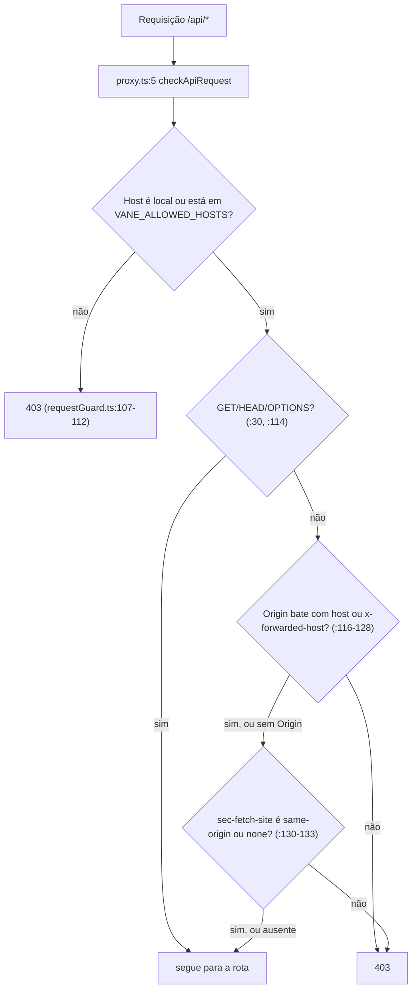
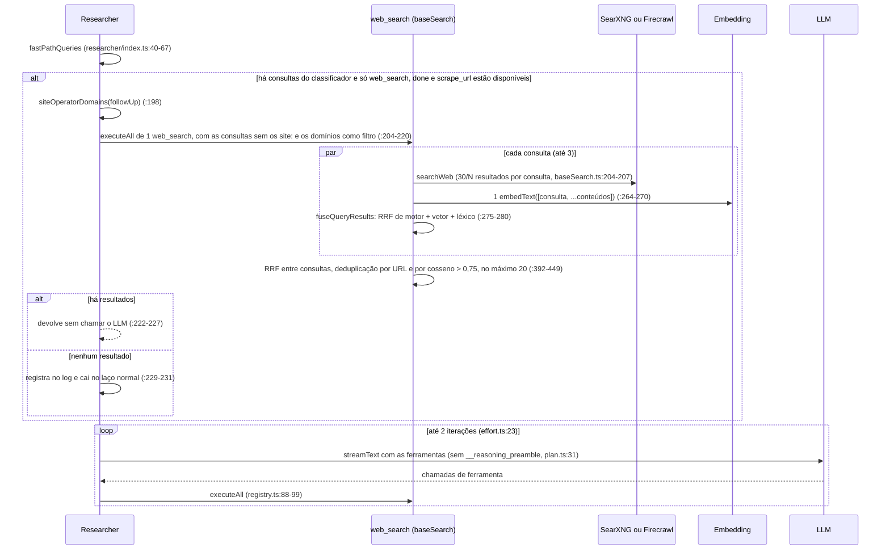
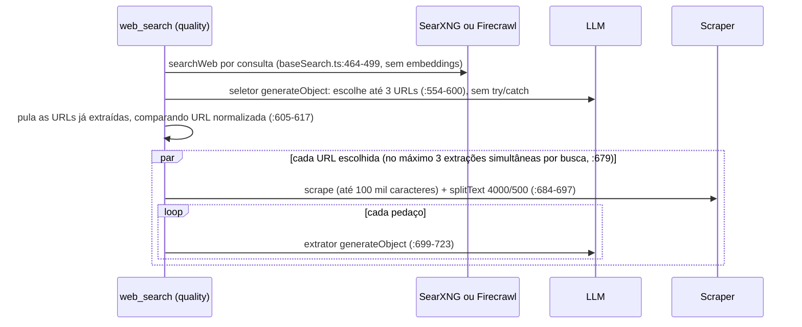
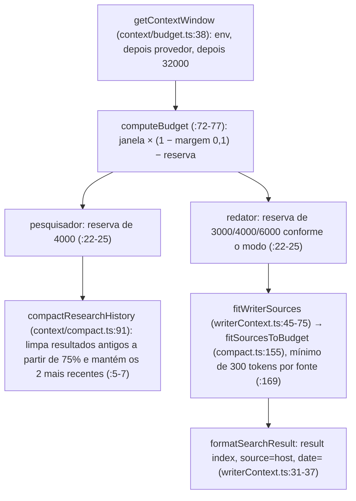
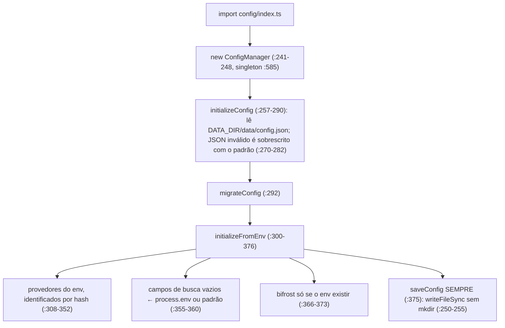
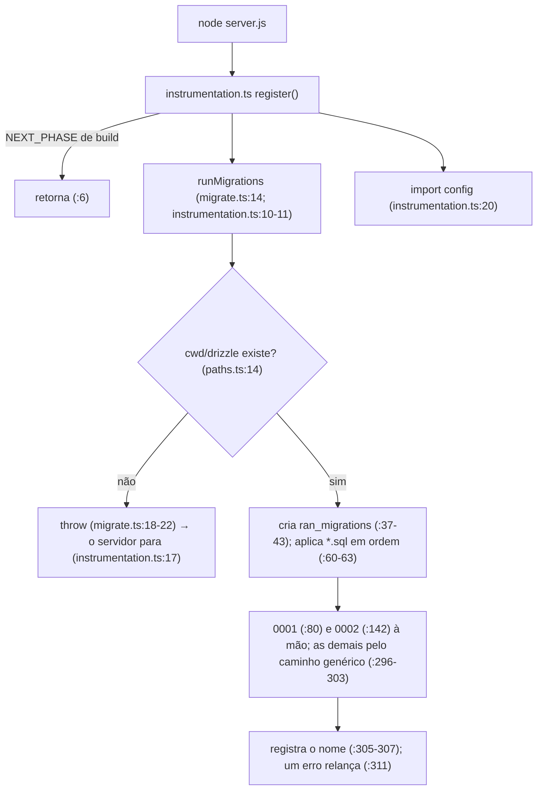
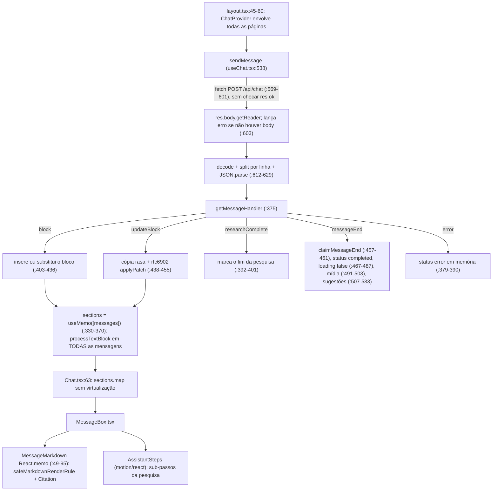

# Vane: arquitetura e fluxo de uma busca (versão atualizada)

Base analisada: `master` em `78f19ff`, lido arquivo a arquivo. O doc anterior foi escrito sobre `3b3799c`. Desde então entraram 103 commits, que mudaram 151 arquivos (+10.131 / −1.335 linhas). Cada afirmação abaixo foi conferida contra o código atual.

Legenda dos diagramas: setas são etapas em sequência; blocos `par` rodam em paralelo; ⏳ marca onde a interface fica esperando sem receber conteúdo novo. Referências são `arquivo:linha` no código atual. Caminhos curtos como `baseSearch.ts` ficam em `src/lib/agents/search/researcher/actions/search/`, e `researcher/...` fica em `src/lib/agents/search/researcher/`.

## 0. O que mudou desde 3b3799c

As mudanças estão agrupadas por tema. Os commits citados são os principais de cada tema.

**Busca e qualidade das respostas**
- **Presets de esforço e caminho rápido do speed** (`891cca7`). `src/lib/agents/search/effort.ts:22-26` define, por modo, o máximo de iterações, quantas páginas ler e se o caminho rápido vale:
  - speed: 2 iterações, 0 páginas, caminho rápido ligado.
  - balanced: 6 iterações, 2 páginas, sem caminho rápido.
  - quality: 25 iterações, 0 páginas pelo preset (o quality tem leitura própria), sem caminho rápido.

  No speed, as consultas que o classificador já sugeriu (`searchQueries`, `classifier.ts:32-36`) vão direto para o `web_search`, sem passar pelo LLM do pesquisador (`researcher/index.ts:190-232`). Desde `78f19ff`, um `site:` digitado pelo usuário vale como filtro de domínio nesse caminho (`researcher/index.ts:198`).
- **Ranking híbrido com RRF** (`1a64c7a`). Em speed e balanced, cada consulta junta três rankings por Reciprocal Rank Fusion: a ordem do motor de busca, a similaridade vetorial e uma pontuação léxica (`ranking.ts:84-100`). As listas das consultas se juntam por RRF somado sobre a URL normalizada (`baseSearch.ts:392-406`). O mesmo commit trouxe:
  - leitura de trechos das 2 melhores páginas no balanced (`baseSearch.ts:459-461`, `:816-854`);
  - uma nova rodada de busca quando a evidência é fraca (`researcher/index.ts:27-28`, `:367-420`).
- **Filtros de busca** (`edc4b71`). O `web_search` aceita `recency`, `domains` (um `-` na frente exclui o domínio) e `language` (`webSearch.ts:14-37`, `filters.ts:46-90`). Também entraram a data da fonte (`publishedDate` → `date=` no contexto, `writerContext.ts:31-37`) e um orçamento por pergunta (no máximo 3 consultas por chamada, `queries.ts:4`).
- **Redator** (`eacf69b`). O redator dá a resposta primeiro (`prompts/search/writer.ts:29`) e mede o tamanho dela pela pergunta, com regras por modo (`writer.ts:19-22`). A regra de "2000 palavras" saiu.
- **Fontes antecipadas** (`f87fcce`). O bloco `source` aparece já na primeira rodada de resultados e é substituído a cada rodada (`researcher/index.ts:137-154`, `:437`, `:451`).
- **`sanitizeCitations`** (`7d36206`). Ao fim do streaming, os `[n]` acima do número de fontes que o redator recebeu são apagados (`search/index.ts:233-244`, `utils/citations.ts:16-32`).
- **Prévia da citação ao passar o mouse** (`3bcd04f`). Mostra favicon, título, data e um trecho de até 280 caracteres (`components/MessageRenderer/Citation.tsx:17`, `:61-103`).
- **Deduplicação por URL normalizada** (`786cbac`, `baseSearch.ts:113-132`).

**Embeddings, LLM e modelos**
- `encoding_format: 'float'` nos embeddings (`050f357`, `openaiEmbedding.ts:18`, `:37`, `:47`). Corrige os vetores zerados que o LM Studio devolvia.
- Os embeddings agora vão em lote: 1 chamada por consulta, com a pergunta e todos os resultados (`baseSearch.ts:264-270`). Um limitador permite 3 chamadas simultâneas e tem prazo de 120 s (`5de3b07`, `baseSearch.ts:63-69`).
- `LLM_TIMEOUT_MS` (`a1425f3`, `models/utils/timeout.ts:14-16`). O padrão é de 5 min, aplicado no cliente OpenAI (`openaiLLM.ts:63`) e no Ollama (`ollamaLLM.ts:68`).
- `generateObject` usa temperatura 0,2 e no máximo 8.192 tokens (`124d69e`, `models/utils/objectDefaults.ts:17-18`). Os dois valores podem ser trocados por `LLM_OBJECT_TEMPERATURE` e `LLM_OBJECT_MAX_TOKENS`. As cercas ```` ```json ```` são removidas antes do parse (`33e00bc`, `models/utils/json.ts`).
- Cache da lista de modelos (`ac091cf`, `models/modelListCache.ts`). Dura 60 s (`MODEL_LIST_CACHE_TTL_MS`, `:17`) e o GET ao provedor tem prazo de 10 s (`MODEL_LIST_TIMEOUT_MS`, `:18`). Isso resolve o "GET /models em toda requisição" do doc antigo.

**Segurança**
- `src/proxy.ts` (o substituto do middleware no Next 16) roda em toda rota `/api/*` (`proxy.ts:26`). Ele bloqueia Host desconhecido (proteção contra DNS rebinding) e requisições de outra origem que alteram estado (CSRF) (`security/requestGuard.ts:104-133`).
- Guarda contra SSRF em toda busca de URL feita pelo servidor (`security/urlGuard.ts:130`, `:184`).
- Os segredos aparecem mascarados em `GET /api/config` e nas rotas de provedores (`config/secrets.ts:26`, `:45`, `api/config/route.ts:34`). Isso fecha o vazamento de chaves do doc antigo.
- `markdownSafety.ts` limita as tags HTML que o markdown pode renderizar.
- Nova rota `/api/favicon`, que busca o favicon pelo servidor com limite de tamanho e cache (`api/favicon/route.ts`).
- `serverActions.ts` faz a geolocalização (freeipapi e BigDataCloud) pelo servidor.

**Robustez**
- `saveFailure` grava `status: 'error'` com os blocos já produzidos (`search/index.ts:31-51`), então a mensagem não fica mais presa em `answering`.
- `APISearchAgent` ganhou `try/catch` (`agents/search/api.ts:12-24`).
- Uma reconexão que falha desliga o `loading` (`22daea1`, `useChat.tsx:647-661`).
- Apagar um chat roda numa transação (`8f0ea02`, `api/chats/[id]/route.ts:49-59`).
- Limites no quality: 3 extrações simultâneas e páginas de no máximo 100 mil caracteres (`6cc1684`, `baseSearch.ts:98`, `:104`).
- O build não abre mais o `db.sqlite` nem roda migrações (`0055892`, `db/open.ts:8-9`, `:39-57`, `instrumentation.ts:6`).
- As migrações são lidas de `cwd/drizzle`, não mais de `DATA_DIR` (`db/paths.ts:14`).
- Os uploads seguem `DATA_DIR`, com leitura de reserva na pasta antiga (`uploads/paths.ts:12-26`).
- WAL ligado (`db/open.ts:17-33`) e índice em `messages.chatId` (`drizzle/0003_messages_chat_id_idx.sql`).
- `GET /api/chats` ganhou paginação (`api/chats/route.ts:31-60`), mas a Biblioteca não a usa (seção 10).

**Interface e bundle**
- `jspdf` é importado sob demanda (`Navbar.tsx:94`).
- O widget de ações é carregado com `next/dynamic` (`Widgets/Renderer.tsx:10`).
- O realce de sintaxe é carregado sob demanda (`CodeBlock/index.tsx:14`, versão leve com poucas linguagens em `highlighter.ts`).
- O markdown é memoizado (`MessageBox.tsx:49-95`).
- `framer-motion` saiu; os componentes usam `motion/react`.

**Benchmark** (`cd1232b`, `4614b9c`, `35cc221`, `cb66854`, `80a8f9c`)
- Contagem de tokens por etapa e sondas de rede (`benchmark/probe.ts`).
- HTTP agrupado por caminho (`instrument.ts:339`).
- Janela de contexto real no relatório.
- Rótulos por etapa (`trace.ts:81`).

**Build, CI e Docker**
- Novo workflow de CI que roda lint, `tsc`, testes, `i18n:check` e build em PR e em push no `master` (`68c3ff8`, `.github/workflows/ci.yaml:31-47`).
- ESLint 9 com `eslint .` (`146771c`, `package.json:10`).
- SearXNG construído num estágio próprio, fixado num commit (`Dockerfile:34-66`, `:37`).
- Imagem final sem `build-essential`, `git` ou `sudo` (`Dockerfile:72-74`). A imagem slim não tem `pip` (`Dockerfile.slim:37`).
- A pasta `data` não vai mais para a imagem (`.dockerignore`).
- Só o `onnxruntime` de CPU é mantido (`Dockerfile:22-30`).
- Dependências: `next` ^16.4.5, `axios` ^1.21.0, `zod` ^4.6.7 (`package.json:28`, `:41`, `:59`).

## 1. Visão geral

| Peça | Onde | Observação |
|---|---|---|
| Rota do chat | `src/app/api/chat/route.ts:103` | Valida com zod (`:34`), carrega o modelo de chat e o de embedding em paralelo (`:130-136`), dispara o agente sem `await` (`:213`) e devolve NDJSON com o cabeçalho `text/event-stream` (`:244`). |
| Guarda de API | `src/proxy.ts:5-26` | Verifica Host, Origin e Sec-Fetch-Site em toda rota `/api/*` (seção 2.3). |
| Orquestrador | `src/lib/agents/search/index.ts:16` | `try/catch` com `saveFailure` (`:27`, `:33-51`). Grava a mensagem, classifica, roda widgets e pesquisa em paralelo, ajusta o contexto ao orçamento, escreve e limpa as citações. |
| Esforço | `src/lib/agents/search/effort.ts:22-26` | Presets por modo: iterações, páginas a ler e caminho rápido. |
| Classificador | `src/lib/agents/search/classifier.ts:45` | 1 `generateObject`. Decide `skipSearch` e os widgets, devolve `standaloneFollowUp` (`:37-41`) e até 3 `searchQueries` (`:32-36`). |
| Pesquisador | `researcher/index.ts:104` | Caminho rápido no speed (`:190-232`) e laço de até 2, 6 ou 25 iterações (`:109`, `:239`). Sincroniza as ferramentas MCP (`:111`), compacta o histórico (`:258-273`) e faz uma nova busca quando a evidência é fraca (`:367-420`). |
| Ações | `researcher/actions/index.ts:10-16`, `mcp.ts:140` | `web_search`, `academic_search`, `social_search`, `scrape_url`, `uploads_search`, `__reasoning_preamble`, `done`, mais as `mcp_*` dinâmicas. |
| Busca | `baseSearch.ts:157`, `src/lib/webSearch.ts:74` | SearXNG ou Firecrawl. Speed e balanced usam embeddings com RRF híbrido; o balanced também lê trechos de páginas. O quality usa seletor LLM, leitura de página e extrator LLM. |
| Ranking | `baseSearch.ts:275-280`, `ranking.ts:84-100` | RRF (k = 60) sobre a ordem do motor, a similaridade vetorial e a pontuação léxica. |
| Leitura de páginas | `src/lib/scraper.ts:49` | Sem navegador. Usa Firecrawl `/v2/scrape` se houver URL configurada; senão `fetchPublicURL` + Readability. |
| Contexto do redator | `writerContext.ts:45-75`, `src/lib/context/{budget,compact}.ts` | Corta as fontes para caber na janela de contexto. |
| Redator | `src/lib/agents/search/index.ts:191-231` | 1 chamada em streaming, depois `sanitizeCitations` (`:235-244`). |
| Sessão e stream | `src/lib/session.ts` | Guarda os blocos e todos os eventos por 30 min (`:17`) para `/api/reconnect/[id]`. |
| Banco | `src/lib/db/index.ts:6`, `db/open.ts` | SQLite (`better-sqlite3`) com Drizzle e WAL. Tabelas `chats` e `messages`, índice em `messages.chatId`. |
| Config | `src/lib/config/index.ts:585` | Singleton que lê `data/config.json` na importação e regrava o arquivo inteiro a cada mudança. |
| Modelos | `models/providers/index.ts:12-21` + Bifrost (`models/registry.ts:46-67`) | OpenAI, Ollama, Gemini, Transformers (só embeddings), Groq, Lemonade, Anthropic, LM Studio, e Bifrost (acrescentado em tempo de execução). |
| Discover | `src/lib/discover/*` | RSS primeiro, SearXNG de reserva, cache em memória (sem mudanças). |
| Benchmark | `src/lib/benchmark/*`, `src/app/api/benchmark/route.ts` | Roda casos fixos e mede chamadas LLM, de embedding e HTTP, com sondas e tokens. |
| Rastreamento | `src/lib/trace.ts` | `AsyncLocalStorage` com eventos de busca e uso de tokens (seção 4.9). |
| i18n | `src/i18n/*` | `next-intl`; locales `pt-BR` (padrão) e `en`, escolhidos pelo cookie `NEXT_LOCALE` (`i18n/request.ts:6-7`). |
| Testes e CI | `vitest.config.ts`, `.github/workflows/ci.yaml` | O CI roda lint, tipos, testes, i18n e build (seção 12). |

Um único modelo de chat, escolhido pelo usuário, atende todas as etapas. Não existe modelo por etapa (inalterado).

## 2. Mapa de rotas e onde cada uma roda

Nenhuma rota declara `runtime = 'edge'`. Só `chat/route.ts:13-14` e `benchmark/route.ts:15-16` declaram `runtime = 'nodejs'` e `dynamic`; as demais usam o padrão, que também é Node.js. O `layout.tsx` raiz é `force-dynamic` (`src/app/layout.tsx:1`). Não há autenticação. A única barreira é o `proxy.ts` (seção 2.3).

### 2.1 Páginas

| Página | Tipo | Observação |
|---|---|---|
| `src/app/layout.tsx` | servidor | Lê `configManager.isSetupComplete()` (`:36`) e `getUIConfigSections()` (`:37`). Renderiza `ChatProvider` + `Sidebar`, ou o `SetupWizard` se a configuração não terminou (`:45-60`). |
| `src/app/page.tsx` | servidor que envolve componentes de cliente | Tela inicial do chat. |
| `src/app/c/[chatId]/page.tsx` | cliente | Abre um chat salvo. `useChat` carrega as mensagens e tenta reconectar (seção 7). |
| `src/app/library/page.tsx` e `layout.tsx` | cliente | Faz `fetch('/api/chats')` sem paginação (`library/page.tsx:28`). |
| `src/app/discover/page.tsx` | cliente | `fetch` de `/api/discover` (`:136`). |
| `src/app/manifest.ts` | servidor | Manifesto PWA. |

### 2.2 Rotas de API (18 arquivos, todas Node.js)

| Rota | Métodos | O que faz |
|---|---|---|
| `/api/chat` | POST | Busca principal com stream NDJSON (seção 3). |
| `/api/reconnect/[id]` | POST | Repete os eventos da sessão em memória; 404 se a sessão não existir (`reconnect/[id]/route.ts:12-14`). |
| `/api/search` | POST | API programática, com e sem stream (seção 4.5). |
| `/api/suggestions` | POST | 1 `generateObject`; responde 500 se falhar (`api/suggestions/route.ts:32-38`). |
| `/api/images`, `/api/videos` | POST | 1 LLM para reescrever a pergunta + SearXNG (seção 4.6). |
| `/api/discover` | GET | RSS e SearXNG com cache (seção 4.2). |
| `/api/weather` | POST | Open-Meteo, usado pelo `WeatherWidget.tsx:79`. |
| `/api/uploads` | POST | Recebe e indexa arquivos (seção 4.1). |
| `/api/chats` | GET | Lista os chats; paginação opcional (`api/chats/route.ts:26-60`). |
| `/api/chats/[id]` | GET, DELETE | Mensagens do chat (`:5`, `:20-22`); apaga numa transação (`:40`, `:49-59`). |
| `/api/config` | GET, POST | Config com segredos mascarados (`:12`, `:34`); grava só campos validados (`:46`, `:62`, `:67`). |
| `/api/config/setup-complete` | POST | Marca o fim do assistente de configuração. |
| `/api/providers`, `/api/providers/[id]`, `/api/providers/[id]/models` | GET, POST, PATCH, DELETE | Gerenciam provedores com `maskProvider` na resposta. |
| `/api/benchmark` | POST | Stream `application/x-ndjson` (`benchmark/route.ts:154`, seção 4.8). |
| `/api/favicon` | GET | Novo. Busca o `favicon.ico` pelo servidor (seção 2.3). |

### 2.3 `proxy.ts` e as guardas de rede



- **Hosts locais** sempre passam: `localhost`, IPs, nomes de um rótulo só, e `.local`, `.lan`, `.internal`, `.home.arpa` (`requestGuard.ts:62-67`). Qualquer outro Host precisa estar em `VANE_ALLOWED_HOSTS` (`isHostAllowed`, `:75`).
- Uma requisição sem `Origin` e sem `Sec-Fetch-Site` (por exemplo, `curl`) passa. É intencional, para a API programática.
- **SSRF** (`security/urlGuard.ts`). `assertPublicHttpURL` (`:130`) resolve o DNS e recusa as faixas privadas e reservadas de IPv4 (`:31-46`) e de IPv6 (`:89-113`). `fetchPublicURL` (`:184`) usa `redirect: 'manual'` e confere de novo cada salto, até 5 (`:178`, `:191-205`). `VANE_ALLOW_PRIVATE_URLS` desliga a checagem (`:123-124`, `:149`). Quem usa: o scraper (`scraper.ts:52`, `:125`) e o favicon.
- **Favicon** (`api/favicon/route.ts`). Valida o domínio com `HOSTNAME_RE` (`:17`) e chama `fetchPublicURL('https://<domínio>/favicon.ico')` com prazo de 5 s (`:88-91`). Lê no máximo 256 KB (`:9`) e guarda até 500 entradas por 24 h em memória (`:10-11`). Responde com CSP e `nosniff` (`:35-36`). O cliente monta a URL em `lib/favicon.ts:6-19`.

## 3. Fluxo de uma busca

### 3.1 Comum aos três modos

```mermaid
sequenceDiagram
  participant UI as Navegador (useChat)
  participant PX as proxy.ts
  participant API as /api/chat
  participant REG as ModelRegistry
  participant AG as SearchAgent
  participant DB as SQLite
  participant LLM
  UI->>PX: POST /api/chat (o histórico inteiro vem do cliente)
  PX->>API: Host/Origin ok
  Note over UI: ⏳ MessageBoxLoading, nenhum byte do stream ainda
  par carregar modelos (route.ts:130-136)
    API->>REG: loadChatModel (hasModel: cache de 60 s ou GET /models com prazo de 10 s)
  and
    API->>REG: loadEmbeddingModel (idem)
  end
  API-->>UI: abre o stream NDJSON (route.ts:244)
  API->>DB: ensureChatExists, SEM await (route.ts:228)
  AG->>DB: SELECT; INSERT, ou DELETE das mensagens seguintes + UPDATE (index.ts:54-92)
  AG->>LLM: classify, generateObject (temperatura 0,2), histórico inteiro (classifier.ts:45-53)
  par Widgets (só os marcados, index.ts:101-118)
    AG->>LLM: 1 generateObject por widget
    AG->>AG: Open-Meteo, Yahoo Finance, mathjs
  and Pesquisa (se skipSearch = false, index.ts:122-130)
    AG->>AG: Researcher (3.2 a 3.4)
    AG-->>UI: bloco source parcial a cada rodada (researcher/index.ts:137-154)
  end
  Note over UI: ⏳ passos da pesquisa e fontes visíveis, nenhum texto da resposta
  AG-->>UI: researchComplete (index.ts:137-139)
  AG->>AG: fitWriterSources (tokeniza e corta as fontes, 3.6)
  Note over UI: ⏳ espera o 1º token do redator
  AG->>LLM: streamText (sistema + contexto + histórico + pergunta crua)
  loop cada pedaço do stream
    AG-->>UI: updateBlock replace /data com o texto ACUMULADO (index.ts:203-231)
  end
  AG-->>UI: updateBlock com o texto limpo, se sanitizeCitations mudou algo (:235-244)
  AG-->>UI: end, que a rota repassa como messageEnd (index.ts:246, route.ts:189-193)
  AG->>DB: UPDATE status=completed e responseBlocks (index.ts:248-260)
  UI->>API: POST /api/suggestions (só depois do fim e se houver fontes, useChat.tsx:507-533)
  opt autoMediaSearch ligado
    UI->>API: POST /api/images e /api/videos, 200 ms depois (useChat.tsx:491-503)
  end
```

- **Reescrita da pergunta.** O classificador devolve `standaloneFollowUp` (`classifier.ts:37-41`) e, agora, `searchQueries` (`:32-36`). O pesquisador recebe o histórico mais uma linha "Standalone question" (`researcher/index.ts:164-174`). As ações recebem a pergunta reescrita em `actionConfig.question` (`:183-184`, `types.ts:71-72`). O redator continua sem a versão reescrita: recebe o histórico mais o `followUp` cru (`search/index.ts:150-156`). `enabledSources` chega ao classificador, mas não entra no prompt. As fontes só habilitam ferramentas (`webSearch.ts:110-112`, `academicSearch.ts:29-32`).
- **Histórico.** O classificador e os widgets recebem o histórico inteiro. O pesquisador recebe os 10 últimos turnos (`researcher/index.ts:164-174`). O histórico vem do cliente em cada POST; o servidor não o lê do banco.
- **Caminho crítico até o primeiro token.** É a soma de:
  - a carga dos modelos (com cache, seção 5.3);
  - a classificação;
  - o maior entre a pesquisa e o widget mais lento;
  - `fitWriterSources`;
  - o tempo até o primeiro token do redator.

  No speed com caminho rápido, a pesquisa não chama o LLM (3.2).
- **Falha.** `searchAsync` captura qualquer erro, emite `error` e chama `saveFailure` (`index.ts:16-29`). `saveFailure` grava `status: 'error'` e os blocos que já existiam (`:33-51`). Ao recarregar, a mensagem aparece como erro, e não mais como `answering` para sempre.
- **Ordem do fim.** O `end` sai antes do `UPDATE` final (`index.ts:246` antes de `:248`). Se o `UPDATE` falhar, o `catch` emite um `error` depois do `end` e `saveFailure` troca o status para `error`. A interface já mostrou a resposta como concluída, mas o histórico vai mostrar erro.
- **Fechar a página** só desliga o listener (`route.ts:235-240`). Não há `AbortController` nem `AbortSignal` em `src/lib/agents` (busca vazia). O agente segue até o fim, o que serve à reconexão, mas gasta LLM e rede.

### 3.2 Speed (caminho rápido + até 2 iterações, sem ferramenta de plano)



- O caminho rápido não vale quando: há arquivos enviados, a pergunta contém `http`, ou o classificador marcou `personal`, `academic` ou `discussion` (`researcher/index.ts:40-67`). Também não vale se existir alguma ferramenta fora de `web_search`, `done` e `scrape_url` (`:31`). Uma ferramenta MCP habilitada, por exemplo, desliga o caminho rápido.
- O caminho rápido aparece no rastreamento como iteração −1 (`:199-203`).
- Se o embedding falhar, os resultados são ordenados pela ordem do motor e por palavras-chave, sem vetor (`baseSearch.ts:314-348`).
- Os resultados com similaridade acima de 0,5 passam (`:72`, `:294-296`). Se sobrarem poucos, entram os 10 melhores (`:74`, `:300-305`).

### 3.3 Balanced (até 6 iterações, com `__reasoning_preamble` e leitura de 2 páginas)

O balanced faz o mesmo que o speed, sem o caminho rápido, mais duas coisas:
- **Plano.** `__reasoning_preamble` vale fora do speed (`plan.ts:31`). O texto do raciocínio é transmitido para o bloco de pesquisa (`researcher/index.ts:296-342`).
- **Leitura de páginas.** `readTopPages` (`baseSearch.ts:816-854`) lê as `readPages = 2` melhores páginas (`effort.ts:24`, `webSearch.ts:134-146`). Para cada página:
  - acrescenta um sub-passo `reading`;
  - chama `Scraper.scrape` com prazo de 8 s (`:81-91`);
  - divide o texto em pedaços de 200 tokens com sobreposição de 30, até 40 pedaços;
  - escolhe 2 trechos por RRF de embedding e léxico, mantendo a ordem da página (`bestPassages`, `:767-808`);
  - junta os trechos ao snippet do resultado.

  O `withTimeout` (`:746-759`) só abandona a espera: o scrape e o embedding continuam rodando em segundo plano, e o embedding segura uma vaga do limitador.

### 3.4 Quality (até 25 iterações; lê e extrai páginas)



- O prompt do quality pede "at least 5-6 iterations" (`webSearch.ts:77`).
- `Scraper.scrape` nunca lança erro nem devolve vazio: numa falha, devolve o título `'Failed to scrape'` (`scraper.ts:73-76`). Por isso o `if (!scrapedData) return;` de `baseSearch.ts:690` nunca dispara, e o extrator gasta chamadas de LLM sobre a página de erro.
- O limitador de extração é criado a cada busca (`:679`). Com consultas em paralelo, o limite real é maior que 3.
- O preset tem `readPages: 0` (`effort.ts:25`), porque o quality usa a própria leitura.

### 3.5 Ferramentas que valem em qualquer modo

| Ação | Habilitada quando | Observação |
|---|---|---|
| `web_search` | fonte `web` ativa (`webSearch.ts:110-112`) | Até 3 consultas por chamada (`queries.ts:4`). `normalizeQueries` descarta consultas já feitas neste bloco de pesquisa, mesmo com filtros diferentes (`queries.ts:23-49`). Se nada sobrar, devolve `NO_NEW_QUERIES_NOTE` (`webSearch.ts:122-128`). |
| `academic_search` | fonte `academic`, `skipSearch` falso e `academicSearch` verdadeiro (`academicSearch.ts:29-32`) | Motores arxiv, google scholar e pubmed (`:59`). Não passa `readPages`. |
| `social_search` | fonte `discussions` | Motor reddit (`socialSearch.ts:59`). |
| `scrape_url` | sempre (`scrapeURL.ts:89`) | Até 3 URLs (`:52-70`). O extrator só roda se a página tiver mais de um pedaço de 4000 tokens; se ele falhar, usa o primeiro pedaço (`:187-218`). O `catch` de `:230-237` nunca roda, porque o scrape não lança erro. Uma página que falhou volta como fonte. |
| `uploads_search` | há `fileIds` (`uploadsSearch.ts:16-19`) | Seção 4.1. |
| `__reasoning_preamble` | modo diferente de speed (`plan.ts:31`) | Só transmite o raciocínio. |
| `done` | sempre (`done.ts:16`) | No ramo `done`, as demais chamadas ainda rodam, e então vem a nova busca por evidência fraca (`researcher/index.ts:367-420`). |
| `mcp_*` | sempre (`mcp.ts:88`) | Seção 4.7. |

- **Nova busca por evidência fraca.** Se o modelo chama `done` sem nenhuma fonte e ainda pode buscar na web, o pesquisador devolve `NO_EVIDENCE_NOTE` (`researcher/index.ts:27-28`) e dá mais uma volta, uma única vez (`retriedForEvidence`, `:132-133`).
- **Nova busca sem filtros.** Quando uma busca filtrada traz pouco, `executeSearch` busca de novo sem os filtros (`baseSearch.ts:157-197`). No quality, "pouco" é 0 resultados; nos outros modos, menos de 3 (`MIN_FILTERED_RESULTS`, `:78`). Isso inclui o `site:` que o usuário digitou no caminho rápido: a resposta pode vir de outros sites sem aviso.
- **Execução.** `executeAll` usa `Promise.all` na ordem das chamadas (`registry.ts:88-99`). `registry.ts:35` usa os helpers de iterador (`values().filter`), que exigem Node 22 ou mais novo.
- **Erros de busca.** `searchSafely` engole os erros e devolve lista vazia (`baseSearch.ts:145-155`).

### 3.6 Montagem do contexto com orçamento e compactação



- O fator 1,2 (`budget.ts:13`) é a folga da estimativa de tokens.
- O `getContextWindow` da classe base devolve `undefined` (`models/base/llm.ts:26-28`). Ollama (`ollamaLLM.ts:59`, `num_ctx` 32000 ou `OLLAMA_NUM_CTX`, `:39-42`) e LM Studio (`lmstudioLLM.ts:13-43`, consulta `/api/v0/models` com prazo de 3 s) informam a janela real. Os demais caem em 32000, salvo se o env definir outro valor.
- No pesquisador, a compactação muda o array de mensagens no lugar, com `splice` (`researcher/index.ts:258-273`).
- `writerContext.ts:69` tem um `console.log` em produção.

### 3.7 Streaming da geração e sugestões

- Cada pedaço do redator faz `replace /data` com o texto acumulado inteiro (`index.ts:221-229`). O tráfego e o trabalho do cliente crescem com o quadrado do tamanho da resposta. Continua aberto.
- Depois do laço, `sanitizeCitations` apaga os `[n]` com `n` maior que o número de fontes que o redator recebeu (`writerSourceCount`, `index.ts:179`, `:233-244`). A API de busca não faz essa limpeza (seção 4.5).
- As sugestões são pedidas pelo cliente depois do `messageEnd`, e só se houver fontes (`useChat.tsx:507-533`). `getSuggestions` devolve `[]` em qualquer falha (`lib/actions.ts:3-33`). As sugestões não são gravadas no banco.

## 4. Outros recursos

### 4.1 Upload de arquivos

- `POST /api/uploads` (`api/uploads/route.ts:5`) chama o `UploadManager`, que aceita só PDF, DOCX e TXT (`uploads/manager.ts:11`).
- O texto é dividido em pedaços de 512 tokens com sobreposição de 128 e vira embeddings (`:115-116`, `:146-147`, `:172-173`). Os arquivos são processados em paralelo com `Promise.all` (`:201`).
- Os arquivos ficam em `DATA_DIR/data/uploads`. A pasta antiga, `cwd/data/uploads`, é lida como reserva (`uploads/paths.ts:12-26`, `manager.ts:39-41`, `:78`).
- `uploads/store.ts` ainda tem o defeito do RRF: o hash do objeto inclui a pontuação (`hashObj(s)`, `:74`), então o mesmo pedaço vindo de duas consultas não se junta. A soma usa `score/(j+1+k)` (`:86`).
- `getFileData` devolve os 3 primeiros pedaços (`store.ts:99-113`) para o prompt do pesquisador (`prompts/search/researcher.ts:333`).
- Apagar um chat não apaga os uploads dele.

### 4.2 Discover (sem mudanças)

O fluxo é o mesmo do doc antigo:
- RSS primeiro (`discover/fetchTopic.ts:104-122`); se vierem menos de 8 itens (`:11`), completa com o motor `bing news` do SearXNG (`:95-96`, `:110`).
- No máximo 60 itens (`:13`), juntados por `mergeItems` (`:63-80`).
- Palavra-chave vira um feed do Google News (`:128`, `:139-157`).
- O cache é em memória (`discover/cache.ts:12`, `:30-31`, `:39`). `rss.ts` tem prazo (`:5`) e limite por feed (`:7`).
- A rota está em `api/discover/route.ts:19`.

### 4.3 Widgets

Sem mudanças de fluxo. `widgets/executor.ts:17-30` roda os widgets marcados em paralelo:
- clima: `weatherWidget.ts:55-58`, `:89`, `:108`;
- ações: `stockWidget.ts:53-56`, `:78-85`;
- cálculo: `calculationWidget.ts:37-40`, `:58`.

Cada widget faz 1 `generateObject`. A saída entra no contexto do redator como "não citar" (`search/index.ts:141-148`). No cliente, o widget de ações é carregado sob demanda (`Widgets/Renderer.tsx:10`). O `WeatherWidget` usa as Server Actions `getApproxLocation` (freeipapi, prazo de 5 s, `lib/serverActions.ts:14-25`) e `reverseGeocode` (BigDataCloud, coordenadas com 2 casas, `:28-51`).

### 4.4 Histórico

- Listar: `GET /api/chats` ordena por `rowid desc` (`api/chats/route.ts:13`). Sem parâmetros, devolve tudo (`:26-29`). Com `limit` (no máximo 500, `:5`) e `cursor`, pagina (`:31-60`). A Biblioteca chama sem parâmetros (`library/page.tsx:28`).
- Abrir: `GET /api/chats/[id]` faz `findMany` por `chatId` (`:20-22`), coberto pelo índice novo.
- Apagar: `DELETE` apaga as mensagens e o chat numa transação (`:49-59`).
- Reescrever: reenviar com um `messageId` existente apaga as mensagens seguintes e regrava (`search/index.ts:71-92`).

### 4.5 API de busca (`POST /api/search`, `docs/API/SEARCH.md`)

- A rota valida só `sources` e `query` (`api/search/route.ts:23-28`). Sem `chatModel`, o acesso de `:37` gera um `TypeError` e a resposta é 500, não 400. `fileIds` é sempre `[]` (`:61`).
- **Sem stream**: resolve no `end` ou no `error` (`:69-111`). No erro, responde 500 com `{message: 'Search error', error}`.
- **Com stream**: envia `init`, `response`, `sources`, `done` e `error` (`:113-200`) como NDJSON, com o cabeçalho `text/event-stream` (`:204`).
- `APISearchAgent` (`agents/search/api.ts`):
  - tem `try/catch` (`:12-24`);
  - rotula as etapas para o rastreamento (`withTraceLabel`, `:27`, `:36`, `:52`, `:129`);
  - captura os erros dos widgets (`:43-46`);
  - roda o pesquisador numa sessão descartável (`:53`) e emite as fontes (`:67-72`);
  - registra `writer_sources` no rastreamento (`:112-117`);
  - transmite a resposta em pedaços (`:141-146`), sem `sanitizeCitations`.

  A lista `sources` pode ter mais itens do que o redator citou, e citações acima do total não são limpas.

### 4.6 Imagens e vídeos

Sem mudanças. Cada um faz 1 `generateObject` para reescrever a pergunta (`agents/media/image.ts:32`, `video.ts:31`) e chama o SearXNG direto, mesmo quando a busca configurada é Firecrawl (`image.ts:47`, `video.ts:46`).

### 4.7 Ferramentas MCP

Sem mudanças:
- `syncMCPActions` (`mcp.ts:140`) lista as ferramentas do `/mcp` do Bifrost (`getMCPServers`, `:31-43`). A lista fica em cache (`LIST_CACHE_MS`, `:21`); uma falha também é guardada no cache, como lista vazia (`:160-163`).
- Cada ferramenta vira uma ação `mcp_<nome>` (`:165-166`).
- Sem lista de permissão, só entram as ferramentas `readOnlyHint` (`isToolAllowed`, `:58-61`).
- Cada chamada tem prazo de 30 s (`:22`) e o resultado é cortado em 8.000 caracteres (`:20`). Erros viram texto (`:111-115`), e a fonte recebe uma URL `mcp://` (`:124`).
- Novidade indireta: uma ferramenta MCP habilitada desliga o caminho rápido do speed (3.2).

### 4.8 Benchmark

```mermaid
sequenceDiagram
  participant UI as Settings/Sections/Benchmark.tsx:84
  participant API as /api/benchmark
  participant PR as probe.ts
  participant RN as runner.ts
  participant AG as SearchAgent
  UI->>API: POST (casos, modelos)
  API->>API: valida (:35-45), carrega os modelos (:56-71), ambiente com janela de contexto (:81-100)
  API->>PR: runProbes, 8 s por sonda (probe.ts:19, :46; route.ts:115-120)
  loop cada caso, em série, parando se a conexão cair (:125-140)
    API->>RN: runCase (runner.ts:51)
    RN->>AG: searchAsync com InstrumentedLLM e InstrumentedEmbedding, dentro de withHttpTrace
    AG-->>RN: eventos, uso de tokens, HTTP por caminho
  end
  API->>API: analyze (analyze.ts:304) + relatório (report.ts)
  API-->>UI: NDJSON application/x-ndjson (:154)
```

- Há 11 casos (`benchmark/cases.ts`): `web-speed`, `web-balanced`, `web-quality`, `academic`, `discussions`, `site-filter`, `follow-up`, `calculation`, `weather`, `images` e `videos`.
- `instrument.ts`:
  - `InstrumentedLLM` (`:98`) lê o rótulo da etapa na hora da chamada (`:158-164`) e soma o uso de tokens.
  - `InstrumentedEmbedding` fica em `:234`.
  - `patchFetch` troca o `globalThis.fetch` uma única vez e só registra dentro de `withHttpTrace` (`:283-329`, `:368`).
  - `classifyURL` (`:339`) agrupa o HTTP por caminho.
- `analyze.ts` classifica os achados como `bug`, `gargalo`, `aviso` ou `sugestao` (`:6`). Ele soma os tokens (`:59`), monta o funil da busca (`:155`), detecta raciocínio escondido (`:185`) e acusa casos sem fontes (`:257`).
- Em `runner.ts`, a promessa `done` (`:93-117`) só é aguardada depois de `searchAsync` (`:119-133`). Se ela for rejeitada antes, pode virar uma rejeição não tratada.

### 4.9 Rastreamento (`src/lib/trace.ts`)

- Os eventos são `search_query`, `search_merge`, `research_iteration` e `writer_sources` (`:9-43`), e o uso de tokens fica em `:49-60`. Tudo é guardado num `AsyncLocalStorage` (`:68`).
- Funções: `trace` (`:72`), `runTraced` (`:77`), `withTraceLabel` (`:81`), `currentTraceLabel` (`:86`), `isUsageTracked` (`:91`), `reportUsage` (`:94`) e `withUsageSink` (`:97`).
- Fora do benchmark não há coletor, e `trace` não faz nada.
- `isUsageTracked` decide se o OpenAI recebe `stream_options.include_usage` (`openaiLLM.ts:190`).

## 5. Camada de provedores de modelo

### 5.1 Provedores

| Provedor | Lista de modelos | Observação |
|---|---|---|
| OpenAI (`providers/openai`) | lista fixa só para `api.openai.com` (`index.ts:138-149`); outros endpoints fazem GET | `loadChatModel` chama `hasModel` (`:165-166`). |
| Anthropic | GET com `modelListSignal` (`anthropic/index.ts:33-35`) | |
| Gemini | idem (`gemini/index.ts:34-38`) | O embedding herda de `OpenAIEmbedding`. |
| Groq | idem (`groq/index.ts:33-35`) | |
| Lemonade | idem (`lemonade/index.ts:46-48`) | O embedding herda de `OpenAIEmbedding`. |
| LM Studio | idem (`lmstudio/index.ts:42-44`) | Janela real via `/api/v0/models` (`lmstudioLLM.ts:13-43`). |
| Ollama | idem (`ollama/index.ts:37-39`) | Cliente próprio. `think: false` (`ollamaLLM.ts:118`), temperatura 0,7 (`:123`). |
| Transformers | local | Só embeddings. |
| Bifrost (`providers/bifrost`, `lib/bifrost.ts`) | `fetchBifrostModels` (`bifrost.ts:57`), sem cache (`bifrost/index.ts:38-40`) | Id fixo `'bifrost'` (`bifrost.ts:5`). Prazo de 10 s (`:16`). Os modelos de embedding são separados por regex (`:32`). `loadChatModel` não confere a lista (`index.ts:51-55`). |

### 5.2 Como a configuração é carregada e gravada



- O caminho é `DATA_DIR` (ou `cwd`) + `/data/config.json` (`:14-17`).
- As seções da interface ficam no mesmo arquivo:
  - provedor de busca, com `env SEARCH_PROVIDER` (`:153`);
  - URL do SearXNG (`:164`);
  - URL do Firecrawl (`:176`);
  - Bifrost e as ferramentas MCP (`:181-237`).
- **Gravação pela interface.** `validateUIConfigWrite` (`:399-431`) aceita só campos de escopo servidor, com o tipo certo, e nunca `modelProviders`. `updateUIConfig` mantém o valor salvo quando recebe a máscara de volta (`:437-440`). `updateConfig` recusa `__proto__` (`:442-465`). `updateModelProvider` restaura os segredos mascarados (`:497-514`, `secrets.ts:73`). `getCurrentConfig` devolve uma cópia profunda (`:580-582`).
- **Leitura no servidor** (`config/serverRegistry.ts`):
  - `getSearxngURL` não cai para o env (`:14-15`);
  - `getSearchProvider` (`:19-22`);
  - `getFirecrawlURL` cai para o env (`:28-33`);
  - `getBifrostConfig` (`:53-68`).

  A chave do Firecrawl só vem de `FIRECRAWL_API_KEY` (`lib/firecrawl.ts`).
- **Leitura no cliente** (`config/clientRegistry.ts:3-36`): lê do `localStorage` (tema, `autoMediaSearch` e outros).
- **Efeito colateral.** Importar o módulo grava o `config.json`. Isso também acontece no `next build`, e falha se a pasta `data` não existir, porque `saveConfig` não cria a pasta. No repositório, `data/.gitignore` garante que a pasta exista.

### 5.3 Lista de modelos com cache (antes: GET em toda requisição)

- `BaseModelProvider.hasModel` (`models/base/provider.ts:37-46`) primeiro procura nos modelos padrão (`cachedDefaultModels`, `:23`) e no cache. Só se não achar pede a lista nova ao provedor.
- O cache (`modelListCache.ts`) fica no `globalThis` (`:45-48`). A chave é o id do provedor mais um sha256 da config (`:50-54`). Dura 60 s (`:17`, `:27`), e o GET tem prazo de 10 s (`:18`, `:31-35`).
- `getCachedModelList` está em `:56` e `invalidate` em `:94`. `removeProvider` invalida a entrada (`registry.ts:177-185`).
- `ModelRegistry` ainda instancia todos os provedores a cada `new ModelRegistry()` (`registry.ts:19-43`), e `chat/route.ts:128` cria um por requisição.
- `getActiveProviders` sempre busca a lista nova (`registry.ts:69-106`), por exemplo em `GET /api/config` (`api/config/route.ts:17-18`).
- `updateProvider` acrescenta uma instância nova sem remover a antiga (`registry.ts:187-235`, `:225`).

### 5.4 Padrões das chamadas

| Chamada | Temperatura | Limite | Prazo |
|---|---|---|---|
| OpenAI `generateText` / `streamText` | 1,0 (`openaiLLM.ts:115-116`, `:178-179`) | sem limite | `LLM_TIMEOUT_MS` (5 min, `:63`) |
| OpenAI `generateObject` | 0,2 (`objectDefaults.ts:17`, `openaiLLM.ts:256-259`) | 8.192 tokens (`:264-265`) | idem |
| Ollama | 0,7 (`ollamaLLM.ts:123`) | `num_ctx` 32000 | `fetchWithHeadersTimeout` (`:68`) |
| Embeddings OpenAI-compatíveis | n/a | n/a | padrão do SDK; só o prazo de 120 s do limitador na busca (`baseSearch.ts:63-69`) |

- `generateObject` usa `create` com `zodResponseFormat` (`openaiLLM.ts:272`) e `parseModelJson`, que remove as cercas e repara o JSON (`:283-285`). Para os modelos de raciocínio da OpenAI, a temperatura é omitida (`objectDefaults.ts:42-43`).
- `usageOf` (`:34`) e `reasoningOf` (`:42`) extraem o uso de tokens e o raciocínio; `reportUsage` manda o uso para o `trace`.
- Não há `AbortSignal` em nenhuma chamada.

## 6. Modelo de dados (Drizzle + SQLite)

### 6.1 Tabelas (`src/lib/db/schema.ts`)

| Tabela | Colunas principais | Índices |
|---|---|---|
| `messages` (`:5-26`) | `id` (pk), `messageId`, `chatId`, `backendId`, `query`, `createdAt`, `responseBlocks` (JSON), `status` (`answering`, `completed` ou `error`) | `messages_chat_id_idx` em `chatId` (`:25`) |
| `chats` (`:33-45`) | `id` (texto), `title`, `createdAt`, `sources`, `files` (JSON) | só a pk |

Não há chave estrangeira. As mensagens de um chat são apagadas explicitamente (4.4).

### 6.2 Migrações e abertura do banco



- `openDatabase` (`db/open.ts:39-57`) usa `':memory:'` durante o build. Fora do build, liga o WAL com novas tentativas em `SQLITE_BUSY` e `synchronous = NORMAL` (`:17-33`).
- O caminho do banco é `DATA_DIR/data/db.sqlite` (`db/paths.ts:5-7`). As migrações vêm de `cwd/drizzle` (`:14`).
- Cada migração roda sem transação (`migrate.ts:79-312`). Uma falha no meio de um arquivo deixa o banco parcialmente alterado e sem registro em `ran_migrations`.

### 6.3 Quando e quanto se lê e escreve

| Momento | Operação | Onde |
|---|---|---|
| Começo da busca | `SELECT` por `chatId` + `messageId`; `INSERT`, ou `DELETE` (id maior) + `UPDATE` | `search/index.ts:54-92` |
| Começo da busca (rota) | `ensureChatExists`, sem `await` | `chat/route.ts:228` |
| Durante o streaming | nada (tudo em memória na sessão) | |
| Fim | `UPDATE status=completed, responseBlocks` com todos os blocos | `index.ts:248-260` |
| Falha | `UPDATE status=error, responseBlocks` | `index.ts:33-51` |
| Biblioteca | `SELECT *` de `chats`, sem limite | `chats/route.ts:26-29` |
| Abrir chat | `SELECT` das mensagens por `chatId` (indexado) | `chats/[id]/route.ts:20-22` |
| Apagar | transação: mensagens + chat | `chats/[id]/route.ts:49-59` |

`responseBlocks` guarda o JSON inteiro de cada resposta, com os resultados das fontes. As linhas crescem com o número de fontes.

### 6.4 Outros dados persistidos

- `DATA_DIR/data/config.json` (seção 5.2).
- `DATA_DIR/data/uploads/` com o arquivo extraído e os embeddings (seção 4.1).
- Só em memória: sessões (`session.ts`), cache do Discover, cache de favicons, cache da lista de modelos e cache da lista MCP. Tudo se perde num reinício.

## 7. Estado da interface (como o stream chega e é desenhado)



- **Parser do stream.** É o mesmo padrão do doc antigo: um buffer parcial, e os eventos já tratados são idempotentes (`replace`, `claimMessageEnd`).
- **`res.ok` não é checado.** Um 403 do `proxy.ts`, um 400 do zod ou um 500 chegam como JSON comum. O laço não encontra nenhum evento conhecido e o `loading` fica ligado (`useChat.tsx:569-603`; inferido pela leitura, não executado).
- **`researchComplete`** lê `message.responseBlocks` da closure, que pode estar desatualizada (`:392-401`).
- **Custo por token.** Cada `updateBlock` recria o array, e `sections` é recalculado por inteiro (`:330-370`). O `MessageMarkdown` memoizado evita refazer o markdown das mensagens antigas, mas a resposta atual é interpretada de novo a cada pedaço.
- **Citações.**
  - `processTextBlock` troca `[n]` por `<citation href=...>` com a URL da fonte, inserida crua (`utils/citations.ts:38-95`).
  - `Citation.tsx` só aceita `http(s)` em `safeHref` (`:54`) e lê as fontes de um contexto (`:14`).
  - `markdownSafety.ts` limita as tags sobrescritas a `think` e `citation` (`:15`) e as de formatação à lista de `:18`. O motivo está no comentário de `:4-12`.
- **Onde a UI espera (⏳).**
  1. Do clique ao primeiro byte: a carga dos modelos (`MessageBoxLoading`, `Chat.tsx:80`).
  2. Do primeiro bloco `research` até haver sub-passos: o indicador "brainstorming" (`MessageBox.tsx:174-187`).
  3. Durante a pesquisa: os sub-passos e, agora, as fontes parciais.
  4. Entre `researchComplete` e o primeiro token: o cabeçalho da resposta com o ícone girando (`MessageBox.tsx:189-201`).
  5. Depois do `messageEnd`: as sugestões chegam numa segunda requisição; imagens e vídeos, depois de 200 ms.
- **Erro.** O banner fica em `MessageBox.tsx:294`.
- **Reconexão.** Ao abrir `/c/[id]`, se a última mensagem estiver `answering`, `checkReconnect` (`useChat.tsx:632-695`) chama `openReconnectStream` (`:645`, `hooks/reconnectStream.ts:5-24`, que devolve `null` se a resposta não for ok). Uma falha marca erro e desliga o `loading` (`:647-661`). O efeito está em `:750-757`. Reescrever fica em `:759-770`.
- **Troca de chat.** O estado é zerado durante a renderização (`:710-719`), não num efeito.
- **Sessões em produção.** O `Map` de sessões só fica no `global` fora de produção (`session.ts:5-9`). Em produção, ele vive no escopo do módulo. Se o bundle carregar o módulo em mais de um chunk, `/api/reconnect` pode não achar a sessão (a confirmar).
- **Bundle.** `jspdf` é importado sob demanda (`Navbar.tsx:94`), o gráfico de ações usa `next/dynamic` (`Widgets/Renderer.tsx:10`) e o realce de sintaxe usa `import()` (`CodeBlock/index.tsx:14`).
- **i18n.** Os textos vêm de `useTranslations`/`getTranslations`. Os prompts em inglês mandam responder no idioma do usuário (`prompts/search/writer.ts:32`, `researcher.ts:28`).

## 8. Build e Docker

### 8.1 Build

- `package.json:8`: `next build --webpack`.
- `next.config.mjs`:
  - `output: 'standalone'` (`:16`);
  - checagem de tipos com `tsconfig.build.json` (`:20-22`), que exclui `perf-audit`, os testes e `vitest.config.ts` (`tsconfig.build.json:3-10`);
  - `serverExternalPackages` (`:23`);
  - `outputFileTracingIncludes` força o `@napi-rs/canvas` da libc detectada, `gnu` ou `musl` (`:10-12`, `:24-29`);
  - `NEXT_PUBLIC_VERSION` (`:30-32`) e a raiz do Turbopack (`:33-35`).
- Durante o build:
  - `instrumentation.ts:6` retorna sem migrar;
  - `db/open.ts` usa um banco em memória;
  - `config/index.ts:375` ainda grava o `config.json`.

### 8.2 Imagens

| Item | `Dockerfile` (completa, com SearXNG) | `Dockerfile.slim` |
|---|---|---|
| Estágio de build | `node:24.5.0-slim` + `python3`, `pip` e `sqlite3` (`:1-3`). `yarn install --frozen-lockfile` (`:8`). Copia os arquivos (`:10-13`), `mkdir data` (`:15`), `yarn build` (`:16`). Remove as variantes de GPU do `onnxruntime` (`:22-30`). | idêntico (`Dockerfile.slim:1-30`) |
| Estágio do SearXNG | `searxng-builder` (`:34-66`): fixo no commit `ac11e14c…` (`:37`). `git fetch --depth 1`, venv, `pip install -e`, versão congelada, `rm .git`. | não tem |
| Estágio final | `python3`, `ca-certificates` e `sqlite3` (`:72-74`). Sem `build-essential`, `git` nem `sudo`. | só `sqlite3` (`:37`) |
| App | `public`, `.next/static` e o standalone (`:78-84`); `drizzle` (`:85`). `mkdir data` e uma pasta `uploads` que ninguém usa (`:89`). | `:42-50`; `mkdir` (`:54`), também com uma pasta sem uso |
| SearXNG | usuário `searxng` (`:91-96`). Copia `settings.yml`, `limiter.toml` e `uwsgi.ini` (`:100-102`); o `uwsgi.ini` não é usado. | não tem |
| Usuário | root (não há `USER`) | root |
| Porta e env | `EXPOSE 3000 8080` (`:109`); `SEARXNG_API_URL` (`:111`) | `EXPOSE 3000` (`:56`) |
| Comando | `entrypoint.sh` (`:105-107`, `:113`) | `node server.js` (`:58`) |

- `.dockerignore` ignora `.git`, `.github`, `.claude`, `.next`, `data`, `docs`, `perf-audit`, `*.md` e `*.log`.
- `docker-compose.yaml` publica só em `127.0.0.1:3000` (`:9`), traz um `VANE_ALLOWED_HOSTS` comentado (`:11`) e monta o volume `vane-data` (`:13`, `:17-18`).

### 8.3 Medição das imagens

As medições do doc antigo (578 MB a slim e 878 MB a completa, em 06/11/2026) foram feitas sobre `3b3799c`. Desde então mudaram:
- o SearXNG passou a ser construído num estágio separado;
- saíram `build-essential`, `git` e `sudo`;
- saíram as variantes de GPU do `onnxruntime`;
- a pasta `data` não vai mais para a imagem.

**Não refiz a medição**: os números antigos não valem para `78f19ff`.

### 8.4 O que roda ao iniciar (imagem completa)

```mermaid
sequenceDiagram
  participant EP as entrypoint.sh
  participant SX as SearXNG (flask, porta 8080)
  participant N as node server.js
  participant I as instrumentation.ts
  EP->>SX: setpriv + env -i, flask run em segundo plano (:8-18)
  Note over EP: ⏳ sonda com fetch do node a cada 250 ms, até 30 s (:24-39); segue mesmo se falhar
  EP->>N: exec node server.js (:44)
  N->>I: register()
  I->>I: runMigrations (cwd/drizzle); um erro para o servidor
  I->>I: import config: lê ou cria config.json, semeia do env, grava
  N-->>N: pronto em :3000 (sessões e caches vazios)
```

O SearXNG continua sem supervisor e roda com o servidor de desenvolvimento do Flask.

## 9. Inventário de chamadas a LLM e a embeddings

| Etapa | Tipo | Quantas por pergunta | Onde |
|---|---|---|---|
| Classificador | `generateObject` | 1 | `classifier.ts:45` |
| Widgets | `generateObject` | 1 por widget marcado | `widgets/*` |
| Pesquisador, speed com caminho rápido | nenhuma | 0 | `researcher/index.ts:190-232` |
| Pesquisador, laço | `streamText` com ferramentas | 1 por iteração (≤ 2, 6 ou 25) | `researcher/index.ts:275-284` |
| `web_search` speed/balanced | `embedText` | 1 por consulta (em lote) | `baseSearch.ts:264-270` |
| Deduplicação por cosseno | reaproveita os vetores | 0 | `baseSearch.ts:411-437` |
| Leitura no balanced | `embedText` | 1 por página lida (≤ 2) | `baseSearch.ts:767-808` |
| `web_search` quality, seletor | `generateObject` | 1 por consulta | `baseSearch.ts:586-598` |
| `web_search` quality, extrator | `generateObject` | 1 por pedaço de 4000 tokens, até 3 páginas | `baseSearch.ts:699-723` |
| `scrape_url` | `generateObject` | 1 por pedaço, se a página tiver mais de um | `scrapeURL.ts:187-218` |
| `uploads_search` | `embedText` | por consulta | `uploads/store.ts` |
| Redator | `streamText` | 1 | `search/index.ts:191-199` |
| Sugestões | `generateObject` | 1 (cliente, depois do fim) | `agents/suggestions/index.ts:21` |
| Imagens / vídeos | `generateObject` | 1 cada, se `autoMediaSearch` | `media/image.ts:32`, `video.ts:31` |
| Upload | `embedText` | 1 por lote de pedaços | `uploads/manager.ts:115-116` |

## 10. Itens do doc antigo: estado atual

| Item | Estado |
|---|---|
| Mensagem presa em `answering` depois de um erro | **Corrigido**: `saveFailure` (`search/index.ts:33-51`). |
| `APISearchAgent` sem `try/catch` | **Corrigido** (`api.ts:12-24`). |
| Segredos em `GET /api/config` | **Corrigido**: `maskConfig` (`config/route.ts:34`). |
| `messages` sem índice | **Corrigido** (`schema.ts:25`, migração 0003). |
| Sem WAL | **Corrigido** (`db/open.ts:17-33`). |
| Migrações dependiam de `DATA_DIR` | **Corrigido** (`db/paths.ts:14`); uma falha agora para o servidor. |
| Uploads ignoravam `DATA_DIR` | **Corrigido** (`uploads/paths.ts:12-26`). |
| `GET /models` em toda requisição | **Corrigido**: cache de 60 s (`modelListCache.ts`). |
| Sem prazo nas chamadas LLM | **Corrigido**: `LLM_TIMEOUT_MS` (`timeout.ts:14-16`). |
| Embeddings por resultado | **Corrigido**: um lote por consulta. |
| Extrator do quality sem limite | **Corrigido em parte**: 3 por busca e 100 mil caracteres. O limite não é global. |
| Bundle pesado (`jspdf`, `lightweight-charts`, realce) | **Corrigido**: importações sob demanda. |
| `framer-motion` | **Removido** (`motion/react`). |
| CI não rodava testes | **Corrigido** (`ci.yaml:31-47`). |
| `next lint` quebrado | **Corrigido**: `eslint .` com ESLint 9. |
| SearXNG clonado do HEAD | **Corrigido**: commit fixo (`Dockerfile:37`). |
| `sudo` NOPASSWD na imagem | **Corrigido**: sem `sudo`. Mas tudo ainda roda como root. |
| Apagar chat sem transação | **Corrigido**. |
| Reconexão que falha deixava `loading` ligado | **Corrigido** (`useChat.tsx:647-661`). |
| Paginação do histórico | **Em parte**: a API pagina, mas a Biblioteca não usa. |
| Stream acumulado (cresce com o quadrado) | **Aberto** (`index.ts:221-229`). |
| Janela padrão de 32k para provedores sem informação | **Aberto** (`budget.ts:6`). |
| Sem `AbortSignal` ao fechar a página | **Aberto**. |
| Sugestões não persistidas e só no fim | **Aberto**. |
| Mídia exige SearXNG mesmo com Firecrawl | **Aberto**. |
| Uploads não são apagados com o chat | **Aberto**. |
| RRF dos uploads com hash que inclui a pontuação | **Aberto** (`store.ts:74`, `:86`). |
| Seletor do quality sem `try/catch` | **Aberto** (`baseSearch.ts:586-598`). |
| Redator sem a pergunta reescrita | **Aberto** (`index.ts:150-156`). |
| `enabledSources` fora do prompt do classificador | **Aberto**. |
| `config.json` gravado no build | **Aberto** (`config/index.ts:375`). |

## 11. Novas observações (não estavam no doc antigo)

1. O extrator do quality roda sobre páginas que falharam: `baseSearch.ts:690` espera um valor falso, mas `scraper.ts:73-76` devolve `'Failed to scrape'`.
2. O `catch` de `scrapeURL.ts:230-237` nunca roda. As páginas que falharam voltam como fontes com o texto de erro.
3. Há um intervalo entre a checagem de DNS e o `fetch` (`urlGuard.ts:159` contra `:193`), que deixa uma brecha de DNS rebinding contra a guarda de SSRF.
4. Um filtro `site:` do usuário é descartado em silêncio quando a busca filtrada traz pouco (`baseSearch.ts:181-196`, a partir do caminho rápido em `researcher/index.ts:198`).
5. `normalizeQueries` descarta a mesma consulta repetida sem filtros (`queries.ts:31-35`). Isso choca com o `NO_EVIDENCE_NOTE` (`researcher/index.ts:27`), que pede ao modelo para buscar de novo.
6. `sendMessage` não checa `res.ok` (`useChat.tsx:569-603`). Um 403 do `proxy.ts` deixa o `loading` ligado para sempre.
7. `researchComplete` lê um estado desatualizado (`useChat.tsx:394-397`).
8. A promessa `done` do `runner.ts` pode ser rejeitada sem tratamento (`:93-133`).
9. `registry.updateProvider` não remove a instância antiga (`registry.ts:225`).
10. `readTopPages` continua trabalhando depois do prazo e segura uma vaga do limitador de embeddings (`baseSearch.ts:746-759`, `:839-847`).
11. Os embeddings não têm prazo próprio (`openaiEmbedding.ts:26-30`). Fora da busca (uploads), não há limite nenhum.
12. `saveConfig` não cria a pasta, e o `config.json` é gravado na importação, inclusive no build (`config/index.ts:250-255`, `:375`).
13. O `UPDATE` final vem depois do `end`. Se ele falhar, sai um `error` depois do `end` e o status muda para `error` (`index.ts:246-260`).
14. O `Map` de sessões não fica no `global` em produção (`session.ts:5-9`).
15. A Biblioteca não usa a paginação (`library/page.tsx:28` contra `chats/route.ts:26-29`).
16. As migrações rodam sem transação (`migrate.ts:79-312`).
17. As imagens rodam como root, e `uwsgi.ini` é copiado sem uso (`Dockerfile:102`, `entrypoint.sh:17`).
18. Há `mkdir` de uma pasta `uploads` que ninguém usa (`Dockerfile:89`, `Dockerfile.slim:54`).
19. A API de busca não chama `sanitizeCitations` (`api.ts:141-148`).
20. No extrator do quality, a ordem em que o conteúdo é acumulado depende de qual extração termina primeiro (`baseSearch.ts:699-723`).
21. `getTokenCount` é importado e não é usado (`search/index.ts:12`).
22. O limitador de extração é criado a cada busca (`baseSearch.ts:679`), então o limite não é global.
23. Há um `console.log` em produção em `writerContext.ts:69`.

## 12. Testes, lint e build

- O CI (`.github/workflows/ci.yaml`) roda em PR e em push no `master`, com Node 24: `yarn install`, `lint`, `tsc --noEmit`, `test`, `i18n:check` e `build` (`:31-47`).
- `docker-build.yaml` continua montando as imagens completa e slim em `master`, `canary` e release.
- O Vitest pega `src/**/*.test.ts` e `perf-audit/eval/**/*.test.ts` (`vitest.config.ts`), usando as imitações de `src/__tests__/helpers/fakes.ts`.
- Não rodei a suíte, o lint nem o build nesta revisão. Os números do doc antigo (22 arquivos e 132 testes; 301 vulnerabilidades no `yarn audit`) são de `3b3799c` e estão desatualizados.

## 13. Divergência entre a documentação e o código

### `README.md`
- `:15` aponta para o documento de arquitetura do upstream.
- `:27` diz "Web search powered by SearxNG", mas a busca também pode usar Firecrawl (`webSearch.ts:58-61`).
- `:31` diz que dá para enviar imagens, mas `manager.ts:11` aceita só PDF, DOCX e TXT.
- `:33` fala em busca por domínio. Isso agora existe (`filters.ts:46`, `site:` no caminho rápido): a afirmação passou a ser verdadeira.
- `:35` fala em "suggestions as you type", mas as sugestões vêm depois da resposta (`useChat.tsx:507-515`).
- `:78` fala em vários volumes (`-v`), mas existe um só.
- `:87` usa `-p 3000:3000` no exemplo da slim, o que contradiz o conselho de publicar só em `127.0.0.1` (`:74`).
- `:93` e `:215` exigem Wolfram Alpha, mas nenhum código usa.
- `:99` diz que só o Quality, ou um pedido com URL, lê páginas. O balanced também lê 2 (`effort.ts:24`, `baseSearch.ts:459`).
- `:166` diz que o Discover usa SearxNG, mas ele usa RSS primeiro (`fetchTopic.ts:104-122`).
- `:226-238` manda usar `npm i` e `npm run start`. O lockfile é do Yarn, e `next start` não funciona com `output: standalone`.
- Faltam `LLM_TIMEOUT_MS`, `MODEL_LIST_CACHE_TTL_MS`, `MODEL_LIST_TIMEOUT_MS`, `LLM_OBJECT_TEMPERATURE`, `LLM_OBJECT_MAX_TOKENS`, `OLLAMA_NUM_CTX`, `VANE_ALLOW_PRIVATE_URLS` e `DATA_DIR`.
- `:318`, sobre o `VANE_ALLOWED_HOSTS` e o `curl` sem Origin, está correto.

### `CONTRIBUTING.md`
- `:22` aponta só para `searxng.ts`, mas a busca passa por `webSearch.ts` e `firecrawlSearch.ts`.
- `:38` diz que as ferramentas são registradas em `index.ts`, mas as MCP são registradas em tempo de execução (`mcp.ts:165-166`).
- `:64-65` usa `npm install` e `npm run dev`; o projeto usa Yarn.
- Não menciona testes, CI, `proxy.ts`, as guardas de segurança, `src/lib/context`, o benchmark nem o i18n.

### `docs/architecture/README.md`
- `:13-17` lista 3 das 18 rotas.
- `:25-27` não cita Firecrawl, MCP nem Bifrost.
- `:31` diz que o LLM produz as citações. Na verdade, o redator escreve `[n]`, o servidor limpa e o cliente transforma em links.
- `:33-35` diz que os embeddings só servem aos uploads. Eles também ordenam os resultados da web e os trechos de página.

### `WORKING.md`
- `:39-43` não fala de Firecrawl, MCP, caminho rápido, leitura de páginas nem orçamento de contexto.
- `:57` não diz que as citações são limpas e ganharam prévia.
- `:70-72` fala em "a search backend" para imagens e vídeos, mas eles sempre usam o SearXNG.

### `docs/API/SEARCH.md`
- `:86` e `:92` dizem que `providerId` é um UUID, mas o Bifrost usa `'bifrost'`.
- `:156` diz SSE, mas o corpo é NDJSON (com o cabeçalho `text/event-stream`).
- `:190` promete 400 para campos faltando, mas sem `chatModel` sai um `TypeError` e 500 (`route.ts:37`). O resto do tratamento de erro agora confere com o código.
- `:100` não diz que `sources` pode ter itens que o redator não citou, nem que a API não limpa as citações.

### `docs/installation/UPDATING.md`
- `:47` roda `docker run -p 3000:3000 -p 8080:8080` sem volume, e os dados se perdem.
- `:13` e `:22` usam `-p 3000:3000`, sem `127.0.0.1`.
- `:64` usa `npm i` e `:76` usa `npm run start`.

### `CLAUDE.md`
- Diz que `yarn lint` roda `next lint`; hoje é `eslint .` (`package.json:10`).
- Diz que o CI só monta imagens; o `ci.yaml` roda lint, tipos, testes e build.

## 14. O que ainda não foi verificado

- O tamanho das imagens e o tempo de subida em `78f19ff` (seção 8.3).
- A suíte de testes, o lint, o build e o `yarn audit` nesta revisão (seção 12).
- Se o `Map` de sessões, fora do `global` em produção, se duplica entre chunks do bundle.
- O comportamento real do `sendMessage` com um 403 do `proxy.ts` (inferido pela leitura).
- A rejeição não tratada do `runner.ts` (inferida pela leitura).
- O efeito da nova busca sem filtros sobre perguntas com `site:` (inferido pela leitura).
