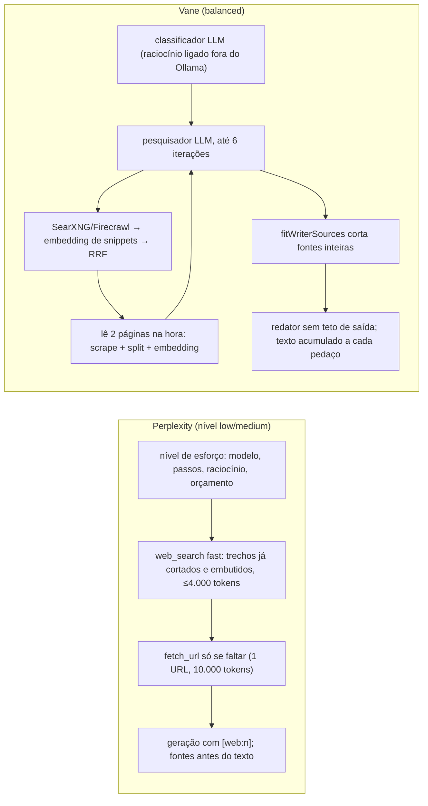

# Vane × Perplexity: funcionalidades e arquitetura (Fase 3 da auditoria)

Data: 07/11/2026. Base do Vane: `master` em `30e2e72` (o código é o de `78f19ff`; os dois commits seguintes só mexem em `perf-audit/`). Referências `arquivo:linha` conferidas no código nesta data. Caminhos curtos: `baseSearch.ts`, `ranking.ts`, `filters.ts`, `webSearch.ts` (da ação) ficam em `src/lib/agents/search/researcher/actions/search/`; `researcher/...` fica em `src/lib/agents/search/researcher/`; `search/index.ts` é `src/lib/agents/search/index.ts`.

Entradas: `perplexity-study.md` (Fase 2, fontes públicas, com a legenda F/P/I), `architecture.md`, `llm-inventory.md`, `upstream.md`, `comparacao-perplexity/relatorio.md` (06/11) e `auditoria-desempenho/benchmark-2026-11-07.md` (rodada real com qwen3.6-35b-a3b no LM Studio + bge-m3). Tudo que é da Perplexity é autodeclarado; o grau de confiança de cada fato está no estudo da Fase 2.

**Estado do relatório de 06/11.** Das 23 sugestões da seção 8 daquele relatório, 11 entraram no `master`: filtros (`filters.ts:46-90`), data e site no contexto (`writerContext.ts:31-37`), trechos de página no balanced (`baseSearch.ts:816-854`), RRF híbrido (`ranking.ts:84-100`), caminho rápido (`researcher/index.ts:190-232`), redator "resposta primeiro" (`prompts/search/writer.ts:28-30`), presets (`effort.ts:22-26`, só iterações, páginas e caminho rápido), nova busca por evidência fraca (`researcher/index.ts:380-419`), orçamento de 30 resultados por chamada (`baseSearch.ts:43`), prévia da citação (`Citation.tsx:17`) e fontes antecipadas (`researcher/index.ts:140-154`). As outras 12 continuam abertas e aparecem em `improvements.md`.

## 1. Funcionalidade por funcionalidade

| Tema | Como a Perplexity faz (fonte) | Como o Vane faz (arquivo:linha) | Diferença | Onde o Vane já é melhor |
|---|---|---|---|---|
| Modos de busca | 6 níveis de esforço versionados (`fast` a `ultra`); cada um fixa modelo, passos (1 a 300), raciocínio, saída máxima e orçamento de busca em tokens; o cliente sobrescreve campo a campo e pode fixar a versão ([effort]) | 3 modos; `EFFORT_PRESETS` só tem iterações (2/6/25), páginas lidas (0/2/0) e caminho rápido (`effort.ts:22-26`). O resto (resultados, trechos, tokens, temperatura) está espalhado em constantes (`baseSearch.ts:43-104`, `budget.ts:22-25`) | O preset do Vane não controla modelo, raciocínio, saída máxima nem orçamento em tokens; não é versionado | Tudo é código aberto e local: o usuário vê e muda o preset; o `speed` chega a 2 chamadas LLM sem nenhum serviço pago (`llm-inventory.md` §2) |
| Qualidade e seleção das fontes | Índice próprio (200+ bi de URLs), recuperação léxica + semântica com recall primeiro, cascata até cross-encoder, em documento e em trecho; parser avaliado por LLM ([search-arch], [photon]) | SearXNG ou Firecrawl (`src/lib/webSearch.ts:58-61`); por consulta, RRF de ordem do motor + cosseno + léxico (`ranking.ts:84-100`, `baseSearch.ts:275-280`), corte em cosseno 0,5 com reserva dos 10 melhores (`:72-74`), RRF entre consultas (`:392-406`), dedup por URL e por cosseno > 0,75 (`:409-437`), até 20 (`:76`). Quality: um LLM escolhe 3 URLs (`:586-600`) | Sem índice, sem reranker de verdade e sem ranking no quality (o seletor vê snippets). O SearXNG herda o viés e os limites dos motores que agrega | O usuário escolhe os motores do SearXNG e pode rodar tudo sem enviar a consulta a um terceiro pago |
| Formato das citações | `[n]` (fast) ou `[web:n]` tipado; liga ao `id` do resultado; a doc manda confiar no `id`/`url` do resultado e nunca na URL escrita pelo modelo; juiz de citação no cookbook da Decisions ([agent-qs], [streaming-cit], [web-search]) | O redator escreve `[n]`; `sanitizeCitations` apaga `n` acima das fontes recebidas (`search/index.ts:233-244`, `utils/citations.ts:16`); o cliente troca `[n]` pela URL da fonte (`citations.ts:38`) e mostra prévia de 280 caracteres (`Citation.tsx:17`) | Ninguém confere se a fonte `n` sustenta a frase. A API (`agents/search/api.ts:141-146`) não limpa as citações | A URL vem sempre dos metadados (nunca do texto do modelo), e a prévia mostra o trecho que o redator leu |
| Perguntas relacionadas | Geradas junto com a resposta, no fim do fluxo ([help-pro]) | 1 `generateObject` pedido pelo cliente depois do `messageEnd` e só se houver fontes (`useChat.tsx:507-533`, `agents/suggestions/index.ts:21`); não são gravadas | Chegam numa segunda ida e volta, depois do fim; somem ao recarregar | Pode-se desligar e não custa nada com modelo local |
| Continuação da conversa | Follow-ups com contexto; `previous_response_id` na API ([help-pro], [agent-qs]) | Histórico vem do cliente a cada POST; o classificador reescreve a pergunta (`classifier.ts:37-41`); o pesquisador vê os 10 últimos turnos (`researcher/index.ts:169`); **o redator recebe a pergunta crua**, sem a reescrita (`search/index.ts:150-156`) | Não há estado de conversa no servidor; o redator pode errar o referente de "e ele?" | Reenviar uma mensagem regrava a resposta e apaga as seguintes (`search/index.ts:71-92`) |
| Upload e análise de arquivos | Imagens, PDF, DOC, DOCX, TXT, RTF como `input_file`; Projects com até 5.000 arquivos; embeddings contextualizados ([changelog], [projects], [ctx-emb]) | PDF, DOCX e TXT (`uploads/manager.ts:11`); pedaços de 512/128 tokens embutidos sem contexto do documento; RRF dos uploads com hash que inclui a pontuação (`uploads/store.ts:74`); o modelo de embedding usado não é registrado | Sem imagem, DOC, RTF; sem contexto do documento no pedaço; trocar o modelo de embedding quebra a busca nos uploads antigos (`llm-inventory.md` §4.21) | Os arquivos e os vetores ficam no disco do usuário (`DATA_DIR/data/uploads`) |
| Imagens e vídeos | `image_search` como ferramenta do agente e classificador de mídia que decide mostrar imagens na resposta ([tools-overview], [changelog]) | 1 LLM reescreve a consulta e chama o SearXNG direto (`agents/media/image.ts:32,47`, `video.ts:31,46`), por botão ou `autoMediaSearch` 200 ms após o fim (`useChat.tsx:491-503`) | Mídia fora da resposta e sempre no SearXNG, mesmo com Firecrawl configurado (`webSearch.ts:65-66` da lib) | Vídeos por busca própria; a Perplexity não documenta uma ferramenta de vídeo na API |
| Focos ou filtros de busca | "Choose sources" (Web, Academic, Finance, Files, social); filtros de domínio (permitir ou bloquear, até 20, com caminho), idioma, país, recência e datas de publicação e de atualização separadas ([search-qs], [domain-filter], [date-filters]) | Fontes `web`, `academic` (arxiv, google scholar, pubmed, `academicSearch.ts:59`), `discussions` (reddit, `socialSearch.ts:59`); filtros `recency`, `domains` (com `-`) e `language` (`filters.ts:46-90`); `site:` digitado vira filtro no caminho rápido (`researcher/index.ts:198`) | Sem país, sem intervalo de datas, sem `last_updated`. Se a busca filtrada traz menos de 3, o Vane busca de novo **sem** o filtro e sem avisar (`baseSearch.ts:181-196`) | O filtro de domínio também descarta resultados de fora quando o motor ignora o operador (`filters.ts`) |
| Pesquisa profunda | Nível alto ou `ultra` (3 agentes em paralelo), `background: true` com estados, reconexão por `starting_after`, cancelamento e Batch API ([effort], [background], [pplx-changelog-1106]) | O quality é síncrono: até 25 iterações (`effort.ts:25`), seletor + extrator LLM; a sessão vive em memória 30 min (`session.ts:17`); `/api/reconnect` repete todos os eventos (`session.ts:80-95`) | Fechar a aba não cancela, reiniciar o servidor perde o trabalho, não há fila nem plano de sub-perguntas | O usuário vê cada passo e cada trecho lido no bloco de pesquisa |
| Uso de ferramentas | `web_search`, `fetch_url`, `image_search`, `finance_search`, `people_search`, `sandbox`, MCP e conectores com `require_approval`, funções próprias ([tools-overview]) | Ações registradas (`researcher/actions/index.ts:10-16`) + MCP do Bifrost como `mcp_<tool>`, só `readOnlyHint` sem lista de permissão, 30 s e 8.000 caracteres (`mcp.ts:20-22,58-61,140`) | Sem aprovação de ferramentas com escrita; finanças só como widget, que não entra no texto com citação | Qualquer servidor MCP atrás do Bifrost entra sem código; nenhuma ferramenta é cobrada por chamada |
| API para desenvolvedores | Agent API, Search API, Embeddings, Decisions, Batch, SDKs Python/Node, MCP remoto, compatível com `/v1/responses` ([llms], [sdk-py], [mcp-repo]) | `POST /api/search` com e sem stream NDJSON (`api/search/route.ts`, `docs/API/SEARCH.md`); sem `chatModel` dá 500 em vez de 400 (`route.ts:37`) | Não há servidor MCP, endpoint compatível com OpenAI, autenticação nem tipos de evento estáveis | Gratuita, local e sem limite de taxa |
| Latência | `fast`: 1 passo, sem raciocínio, tier `priority`; Fast Search p50 160 ms / p95 230 ms; trechos pré-extraídos e pré-embutidos na indexação ([effort], [photon], [cobbledb]) | Medido (07/11, LM Studio): classificador 43 s em média por causa do raciocínio; raciocínio = 86% dos tokens gerados; Firecrawl 1 a 4 s por consulta; redator 4 a 8 s até o 1º token, 46 a 72 tok/s (`benchmark-2026-11-07.md` §2, §6). Raciocínio só é desligado no Ollama (`ollamaLLM.ts:118`) | A latência do Vane é dominada pelo modelo local pensando em chamadas JSON, não pela busca | O caminho rápido do speed pula o LLM do pesquisador (`researcher/index.ts:190-232`) |
| Custo | Search API US$ 5 (fast US$ 1) por mil; `web_search` US$ 1 a 2,50 por mil; tokens por modelo; embeddings a partir de US$ 0,004/1M ([pricing]) | Custo marginal zero com modelos locais. Com provedor pago não há teto: um quality típico faz ~45 chamadas LLM e o máximo teórico é ~577 (`llm-inventory.md` §2); nada mede custo fora do benchmark (`trace.ts:94`) | Sem orçamento de custo por pergunta nem aviso | Rodar 100% local não custa nada por pergunta |
| Privacidade e execução local | Nuvem; Computer local no Mac desde nov/2026 (Qwen 3.6) ([local-mac]) | Tudo pode rodar local: SearXNG na imagem completa (`Dockerfile:34-66`), LM Studio/Ollama/Transformers, SQLite em `DATA_DIR`. Sem telemetria (busca por posthog/sentry/analytics sem resultado). Saem do servidor: consultas aos motores do SearXNG, freeipapi e BigDataCloud no widget de clima (`serverActions.ts:15,27`), Nominatim (`weatherWidget.ts:89`), Yahoo Finance, favicons (`api/favicon/route.ts`) | A Perplexity vê toda pergunta; o Vane só expõe a consulta aos motores escolhidos | **Principal vantagem do Vane**: nenhum dado do usuário precisa sair da máquina; sem login, guarda de Host/Origin (`proxy.ts:26`) e SSRF (`urlGuard.ts:130,184`) |

### 1.1 Notas por tema

- **Modos.** O preset da Perplexity é um contrato: "as atualizações mantêm a faixa de custo e latência; o que muda é a qualidade" ([effort]). No Vane, mudar o `speed` muda também o que o eval mede, por isso cada linha de `EFFORT_PRESETS` deveria ter uma referência própria no eval (ver `improvements.md`, G1-01).
- **Fontes.** O seletor do quality vê `JSON.stringify(result)` com `similarity: 1`, `embedding: []` e `publishedDate` (`baseSearch.ts:595`): tokens a mais e nenhum sinal de ranking. Na Perplexity, a escolha final é feita sobre trechos já ranqueados.
- **Fontes com erro.** `Scraper.scrape` nunca lança: devolve o título `'Failed to scrape'` (`scraper.ts:74`). O quality testa `if (!scrapedData)` (`baseSearch.ts:690`), que nunca dispara, e passa a página de erro pelo extrator; o `scrape_url` devolve "Failed to fetch content…" como fonte citável (`scrapeURL.ts:230-237`); o MCP faz o mesmo com o texto do erro (`mcp.ts:111-115`). O balanced já filtra o caso (`baseSearch.ts:842`).
- **Citações.** A Perplexity avisa que um `[n]` pode chegar partido entre dois deltas ([streaming-cit]). O Vane não sofre isso porque reenvia o texto acumulado, mas paga com o tráfego quadrático (2.7).
- **Relacionadas.** Existe o tipo de bloco `suggestion` (`useChat.tsx:357`), mas o servidor não o emite; quem pede é o cliente.
- **Conversa.** O histórico inteiro vai ao classificador e aos widgets a cada pergunta, sem compactação; numa conversa longa com modelo local, isso cresce o tempo de prefill do classificador, que já é a etapa mais lenta.
- **Arquivos.** O upload manda o documento inteiro numa só chamada de embedding, fora do limitador e sem prazo próprio (`uploads/manager.ts:115-116`, `llm-inventory.md` §4.9, §4.22).
- **Filtros.** A volta "sem filtro" protege contra zero resultados, mas desfaz o `site:` do usuário sem dizer nada (`architecture.md` §11.4). A Perplexity não tem esse comportamento documentado: com filtro, devolve o que houver.
- **Pesquisa profunda.** O padrão `background` → polling → `starting_after` → `cancel` da Perplexity casa com o que o Vane já tem em partes: `SessionManager` com eventos em ordem e `/api/reconnect/[id]`. Falta a persistência e o índice do evento.
- **Ferramentas.** Uma ferramenta MCP habilitada desliga o caminho rápido do speed (`researcher/index.ts:31,40-67`), então ligar o Bifrost deixa o speed mais lento mesmo em perguntas que não usam MCP.
- **API.** A API e a UI usam redatores diferentes: a API manda contexto `''` quando não há busca (`api.ts:95`), a UI manda um marcador (`search/index.ts:158-159`). O benchmark mede o caminho da API, não o da UI (`llm-inventory.md` §4.27).
- **Latência.** A estimativa da Fase 1 é que os 33.669 tokens de raciocínio somaram ~11 dos ~15 min da bateria (a 50 tok/s). É estimativa, não medição; o número de chamadas e os tokens são medidos.
- **Custo.** O SDK `openai` repete 2 vezes; o Bifrost, se configurado com retentativas, repete de novo. Com provedor pago, um erro 5xx pode custar 3× ou 9× (a conferir na config do Bifrost).
- **Privacidade.** O widget de clima manda o IP público do servidor à freeipapi e coordenadas arredondadas à BigDataCloud (`serverActions.ts:13-51`). Para quem quer 100% local, isso deveria ser uma opção desligável.

## 2. Lógica e arquitetura

### 2.1 Pipeline da resposta

| Etapa | Perplexity | Vane | Leitura |
|---|---|---|---|
| Entendimento | O nível de esforço fixa tudo antes da busca; o modo "Best" escolhe o modelo pelo tipo de pergunta (F [effort], [help-pro]) | 1 `generateObject` (`classifier.ts:45`) decide `skipSearch`, widgets, até 3 consultas e a reescrita; sem `try/catch`, uma falha derruba a resposta (`search/index.ts:94`) | Mesma ideia; no Vane o classificador é a etapa mais cara medida (43 s) e um ponto único de falha |
| Plano | Pro Search separa plano e execução (P [langchain]) | `__reasoning_preamble` só transmite o raciocínio (`plan.ts:31`); não há sub-perguntas | Plano explícito só faz sentido no quality/pesquisa profunda |
| Recuperação | Índice próprio, léxico + denso, recall primeiro (F [search-arch], [q2d]) | Motores externos, 30 resultados divididos entre as consultas (`baseSearch.ts:43,204-207`) | O Vane não controla o recall; só reordena o que o motor devolve |
| Leitura | `fetch_url` é exceção (1 URL, 10.000 tokens); o `snippet` já traz o texto extraído (F [effort], [search-qs]) | Balanced lê 2 páginas na hora (8 s cada, `baseSearch.ts:81-91`); quality lê 3 e passa cada pedaço de 4.000 tokens por um LLM (`:684-723`) | A Perplexity paga a extração na indexação; o Vane paga a cada pergunta |
| Geração | Prompt curto, honesto sobre lacunas, ajustado por modelo; fontes antes do texto (F [prompt-guide], [streaming-cit]) | Prompt curto, resposta primeiro, tamanho por modo (`writer.ts:19-30`); fontes antecipadas | Já alinhados. Falta teto de saída: pesquisador e redator não têm `max_tokens` (`openaiLLM.ts:181`) |
| Pós-processamento | URL dos metadados, juiz de citação opcional (F [web-search], [llms]) | `sanitizeCitations` por índice (`search/index.ts:233-244`) | Falta a checagem de suporte (frase × trecho) |

O caminho crítico do Vane até o 1º token é: carga dos modelos (cache de 60 s) → classificador → max(pesquisa, widget mais lento) → `fitWriterSources` → 1º token do redator (`architecture.md` §3.1). Os widgets só começam depois do classificador (`search/index.ts:94-101`), e as sugestões só depois do fim.

### 2.2 Estratégia de busca e ranking

| Aspecto | Perplexity | Vane |
|---|---|---|
| Unidade de ranking | Trecho autocontido, cortado na indexação (F [search-arch]) | Snippet do motor no speed/balanced; trechos de 200 tokens só nas 2 páginas lidas do balanced (`baseSearch.ts:84-89`) |
| Estágios | Léxico + denso baratos → cross-encoder, em documento e em trecho (F) | RRF de 3 listas por consulta e RRF entre consultas (`ranking.ts:76-100`, `baseSearch.ts:392-406`); sem cross-encoder |
| Corte | Orçamento de tokens; `max_results` dividido entre queries (F [web-search]) | Limiar fixo de cosseno 0,5 com reserva top-10 (`baseSearch.ts:72-74,294-305`) e teto de 20 resultados |
| Diversidade | Mais queries = mais diversidade, não mais volume (F) | Igual: 30 resultados por chamada divididos entre as consultas (`baseSearch.ts:36-43`) |
| Re-busca | Corte de qualidade com nova busca (I [aiep]) | Nova volta se `done` vier sem fontes (`researcher/index.ts:380-419`); nova busca sem filtro se < 3 (`baseSearch.ts:157-197`) |
| Quality | Mesma cascata, mais passos | Um LLM escolhe 3 URLs vendo o JSON cru dos resultados, com metadados internos (`baseSearch.ts:595`), sem ranking prévio |

O ponto fraco medido foi outro: com o LM Studio, os vetores chegavam zerados e o RRF virava "ordem do motor + léxico" sem ninguém perceber (`benchmark-2026-11-07.md` §1; corrigido em `050f357`, `openaiEmbedding.ts:18`). Qualquer mudança de ranking precisa de um sinal no benchmark que acuse similaridade constante.

### 2.3 Uso de embeddings

| | Perplexity | Vane |
|---|---|---|
| Quando | Na indexação, por trecho, guardado no CobbleDB por URL (F [cobbledb]) | Na pergunta: 1 `embedText([consulta, ...snippets])` por consulta (`baseSearch.ts:264-270`), 1 por página lida (`:787`), por upload (`uploads/manager.ts:116,147,173`) |
| Para quê | Recuperação densa e ranking de trechos | Ranking (RRF), limiar 0,5, dedup > 0,75, escolha de trechos, busca nos uploads |
| Modelo | `pplx-embed` (contextualizado, Matryoshka, int8/binário) (F [emb-qs]) | O que o usuário configurar; padrão local pelo Transformers |
| Cache | Pré-computado, nunca na hora | Nenhum: a mesma página lida duas vezes na mesma pesquisa é embutida duas vezes (`benchmark-2026-11-07.md` §6) |
| Vazamento | — | O vetor de cada resultado vai para `metadata.embedding` (`baseSearch.ts:290`) e entra no bloco de pesquisa por `replace /data/subSteps` (`:361-385`). O `rfc6902` guarda uma cópia; o `delete` de `:443` só limpa o objeto original. Os vetores ficam nos eventos da sessão por 30 min, vão para o navegador e para `messages.responseBlocks` (`search/index.ts:248-253`) (`upstream.md` nota A) |

### 2.4 Montagem do contexto

| | Perplexity | Vane |
|---|---|---|
| Orçamento | `max_tokens_per_page` e `max_tokens` total, por chamada de busca (F [search-qs]) | Por janela do modelo: `computeBudget` = janela × 0,9 − reserva (`context/budget.ts:22-25,72-77`); `fitWriterSources` corta fontes inteiras, mínimo de 300 tokens por fonte (`compact.ts:155,169`) |
| Formato | Trechos numerados com `id`, `url`, `date`, `last_updated` (F) | `<result index=N title= source= date=>` (`writerContext.ts:31-37`); sem `last_updated` |
| Histórico do agente | Compactação a partir de 150.000 tokens no `xhigh` (F [effort]) | `compactResearchHistory` troca resultados antigos por uma linha a partir de 75% (`compact.ts:5-7,91`) |
| Estimativa | Tokenizador do próprio modelo | cl100k × 1,2 (`budget.ts:13`); janela de 32k quando o provedor não informa (`budget.ts:6`) |

A diferença essencial: a Perplexity limita **por página e por chamada**, antes de o contexto existir; o Vane limita **depois**, cortando o que já foi buscado, lido e embutido.

### 2.5 Roteamento de modelos

| | Perplexity | Vane |
|---|---|---|
| Por etapa | Modelo, raciocínio e tier por nível; extração com modelo pequeno (gpt-6-luna) (F [effort]) | Um único modelo de chat para as 13 chamadas LLM (`llm-inventory.md` §0) |
| Raciocínio | `reasoning.effort` de `minimal` a `max`; `none` no `fast` (F) | Desligado só no Ollama, por substring do nome (`ollamaLLM.ts:44-53,118`); OpenAI, LM Studio, Gemini, Groq, Lemonade e Bifrost não recebem nada |
| Fallback | Lista de até 5 modelos; failover só antes do 1º token (F [fallback], [orch-routing]) | SDK repete 2× em 408/409/429/5xx (padrão do `openai` 6.x); sem fallback de modelo; o Bifrost pode ter o seu |
| Saída estruturada | JSON Schema; schema novo custa 10 a 30 s na 1ª vez (F [output-control]) | `zodResponseFormat` estrito, temperatura 0,2, teto de 8.192 (`openaiLLM.ts:256-272`); envia `$schema`, que servidores estritos recusam (upstream #1233) |

### 2.6 Cache

| Camada | Perplexity | Vane |
|---|---|---|
| Prompt | `prompt_cache_key` estável por nível (~5%); afinidade de implantação (F [effort], [orch-routing]) | Nenhum controle. O prompt do pesquisador põe "iteration i of N" no topo (`prompts/search/researcher.ts:22,108,210`), o que muda o prefixo a cada iteração e impede o reaproveitamento do cache de prefixo do llama.cpp/LM Studio (a medir) |
| Páginas | CobbleDB: trechos e vetores por URL, hedging de leitura (F [cobbledb]) | Nenhum; nem dentro da mesma pesquisa |
| Busca | Índice próprio | Nenhum cache de consultas; limite de 2 buscas simultâneas e 2 novas tentativas (`webSearch.ts:7,74-80` da lib) |
| Metadados | — | Lista de modelos 60 s (`modelListCache.ts:17`), MCP (`mcp.ts:21`), favicon 24 h, Discover em memória |

### 2.7 Streaming

| | Perplexity | Vane |
|---|---|---|
| Eventos | Tipados: `search_queries`, `search_results`, `fetch_url_*`, `output_text.delta`, `completed`, com `sequence_number` (F [sdk-py]) | NDJSON com `block`, `updateBlock` (patch RFC 6902), `researchComplete`, `messageEnd`, `error`, sob o cabeçalho `text/event-stream` (`chat/route.ts:244`) |
| Texto | Delta | `replace /data` com o texto **acumulado** a cada pedaço (`search/index.ts:221-229`): tráfego e trabalho do cliente crescem com o quadrado do tamanho |
| Reconexão | `starting_after=N` | Repete todos os eventos desde o início (`session.ts:80-95`), com os vetores de embedding junto |
| Desconexão | Cancelamento explícito (`/cancel`) | Fechar a aba só tira o ouvinte (`chat/route.ts:235-240`); não há `AbortSignal` em `src/lib/agents`; o trabalho segue até o fim |
| Keepalive | Eventos de progresso contínuos | Só o cabeçalho `Connection: keep-alive`; proxies cortam gerações longas sem bytes (upstream #1051) |

### 2.8 Avaliação de qualidade

| | Perplexity | Vane |
|---|---|---|
| Harness | `search_evals` (MIT): hash da configuração na pasta, retomada, "falhas contam zero / excluídas", custo por tarefa; 0.1 mede APIs de busca, 0.2 mede sistemas (F [search-evals]) | `perf-audit/eval`: 30 perguntas pt-BR × 3 modos, SearXNG e páginas gravadas, checagens automáticas, juiz local com rubrica, comparação com referência (`eval/README.md`, `eval-plan.md` §3) |
| Trocas | Fast Search aceito com DCG pior porque a qualidade final não mudou e o custo caiu 68% (F [photon]) | Regra: nenhum critério cai > 0,3, nenhuma pergunta cai ≥ 2, checagens em 100% (`eval-plan.md` §3). O `run.ts` já grava tempo e número de chamadas (`run.ts:230`), mas não tokens de raciocínio nem custo |
| Produção | Cada resposta vira dado de qualidade; correções do usuário viram RFT (F [search-arch], [rwe]) | Benchmark nas configurações (`src/lib/benchmark/`): mede tokens, HTTP e acusa raciocínio oculto (`analyze.ts:185`); nada é coletado em produção |

### 2.9 Onde o tempo vai (medido no Vane, 07/11)

| Etapa | Chamadas | Tempo de modelo | Tokens de raciocínio | Equivalente na Perplexity |
|---|---|---|---|---|
| Classificador | 8 | 347,9 s (43 s em média) | 5.187 num único caso (balanced) | Roteamento pelo nível; sem LLM visível no `fast` |
| Redator | 8 | 326,1 s | 12.003 | `reasoning: none` no `fast`, `minimal` no `low` |
| Pesquisador | 7 | 79,0 s | 1.168 | Passos com `reasoning.effort` do nível |
| Widget (cálculo) | 2 | 54,0 s (49 s para "15% de 2.340") | 2.207 | Não há widget; seria `sandbox` ou o próprio texto |
| Mídia | 2 | 33,5 s | até 1.143 | Classificador de mídia, sem custo visível |

Fonte: `benchmark-2026-11-07.md` §2 (qwen3.6-35b-a3b no LM Studio, bge-m3). Uma rodada só, 10 casos: serve para ordenar prioridades, não para fixar ganhos. A medição de antes e depois de cada mudança fica para a Fase 4/5.

### 2.10 Lacunas em uma linha

| Lacuna | Tipo | Onde está a sugestão |
|---|---|---|
| Raciocínio ligado nas chamadas JSON fora do Ollama | latência | G1-02, ADR 0002 |
| Vetores de embedding em blocos, eventos, rede e banco | memória, rede | G1-03 |
| Classificador, seletor e ferramenta inventada derrubam a resposta | robustez | G1-04 |
| Páginas e ferramentas que falharam viram fontes | qualidade | G1-05 |
| Pesquisador e redator sem teto de saída | latência, custo | G1-06 |
| Prefixo do prompt do pesquisador muda a cada iteração | latência | G1-07 |
| Mesma página lida e embutida de novo | latência | G1-08, ADR 0003 |
| Orçamento em contagem de resultados, não em tokens | qualidade, contexto | G1-17, ADR 0004 |
| Sem cancelamento, replay completo, texto acumulado | rede, CPU | G1-13, G1-14 |
| Quality síncrono e preso à sessão de 30 min | funcionalidade | G3-01, ADR 0005 |
| Provedores pagos da Perplexity | opcional | G2, ADR 0001 |

**Conclusão.** O Vane já copiou os padrões baratos (filtros, datas, RRF, trechos, caminho rápido, resposta primeiro). O que o separa da Perplexity agora não é ranking, é **onde o tempo vai**: raciocínio em chamadas JSON, extração e embedding na hora da pergunta, nenhum cache e nenhum teto de saída. As maiores alavancas são locais e não precisam de serviço pago. As sugestões estão em `improvements.md`; as decisões de arquitetura, em `adr/`.

## Fontes

Todas da Perplexity, lidas na Fase 2 (detalhe e grau de confiança em `perplexity-study.md`).

[effort]: https://docs.perplexity.ai/docs/agent-api/effort.md
[search-arch]: https://www.perplexity.ai/hub/blog/architecting-and-evaluating-an-ai-first-search-api
[photon]: https://www.perplexity.ai/hub/blog/photon
[cobbledb]: https://www.perplexity.ai/hub/blog/cobbledb
[q2d]: https://www.perplexity.ai/hub/blog/q2d-web
[agent-qs]: https://docs.perplexity.ai/docs/agent-api/quickstart.md
[streaming-cit]: https://docs.perplexity.ai/docs/cookbook/articles/streaming-citations/README.md
[web-search]: https://docs.perplexity.ai/docs/agent-api/tools/web-search.md
[help-pro]: https://www.perplexity.ai/help-center/en/articles/10352903-what-is-pro-search
[changelog]: https://docs.perplexity.ai/docs/resources/changelog.md
[projects]: https://www.perplexity.ai/hub/blog/spaces-are-now-projects
[ctx-emb]: https://www.perplexity.ai/hub/blog/contextual-embedding-beyond-the-gold-passage
[tools-overview]: https://docs.perplexity.ai/docs/agent-api/tools/overview.md
[search-qs]: https://docs.perplexity.ai/docs/search/quickstart.md
[domain-filter]: https://docs.perplexity.ai/docs/search/filters/domain-filter.md
[date-filters]: https://docs.perplexity.ai/docs/search/filters/date-time-filters.md
[background]: https://docs.perplexity.ai/docs/agent-api/background-mode.md
[pplx-changelog-1106]: https://www.perplexity.ai/changelog/teammates-fully-local-computer-on-mac-and-voice-mode
[llms]: https://docs.perplexity.ai/llms.txt
[sdk-py]: https://github.com/perplexityai/perplexity-py
[mcp-repo]: https://github.com/perplexityai/modelcontextprotocol
[pricing]: https://docs.perplexity.ai/docs/getting-started/pricing.md
[local-mac]: https://www.perplexity.ai/hub/blog/perplexity-computer-now-runs-fully-local-on-mac
[langchain]: https://www.langchain.com/breakoutagents/perplexity
[prompt-guide]: https://docs.perplexity.ai/docs/agent-api/prompt-guide.md
[fallback]: https://docs.perplexity.ai/docs/agent-api/model-fallback.md
[orch-routing]: https://docs.perplexity.ai/docs/router/routing-and-reliability.md
[output-control]: https://docs.perplexity.ai/docs/agent-api/output-control.md
[aiep]: https://prajwalamte.github.io/AI-Engineering-Patterns/case-studies/perplexity-ai/
[search-evals]: https://github.com/perplexityai/search_evals
[rwe]: https://www.perplexity.ai/hub/blog/learning-from-real-world-experience
